# trofeo_lcd

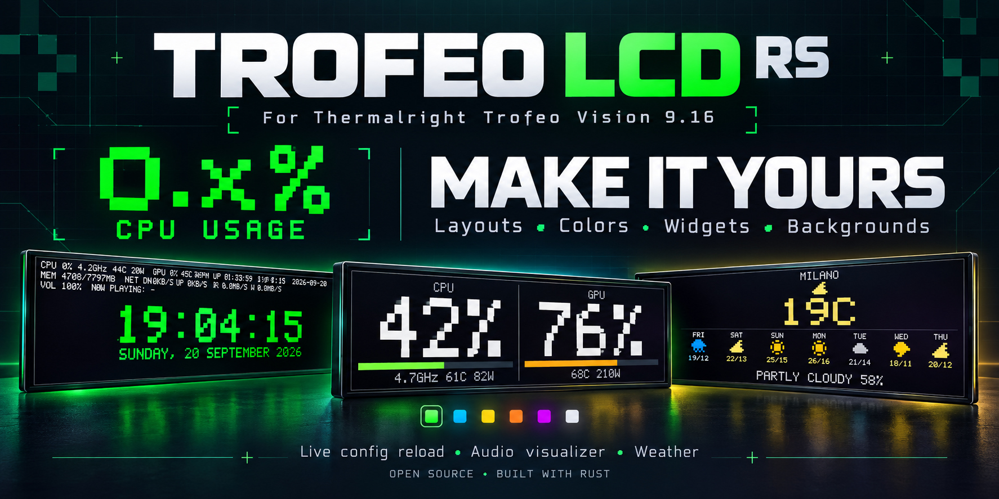
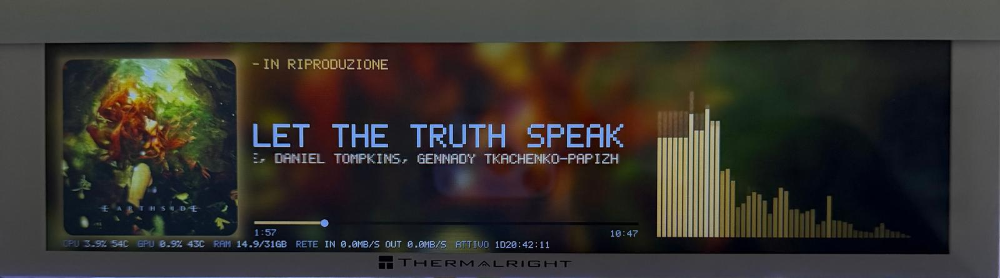
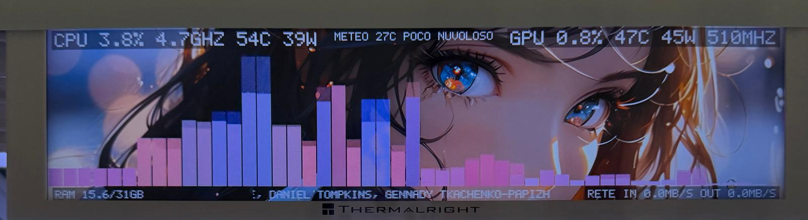
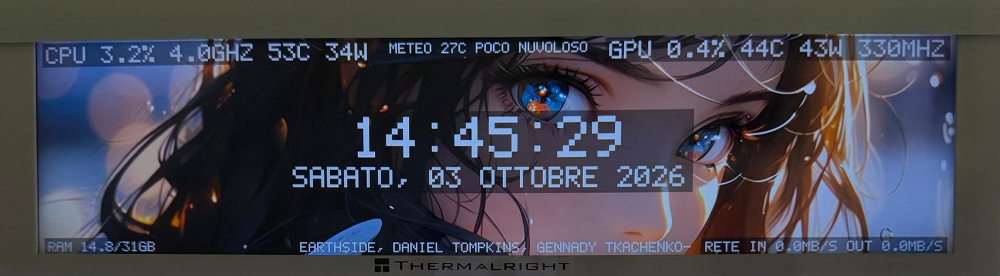
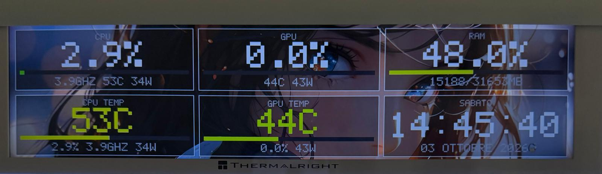
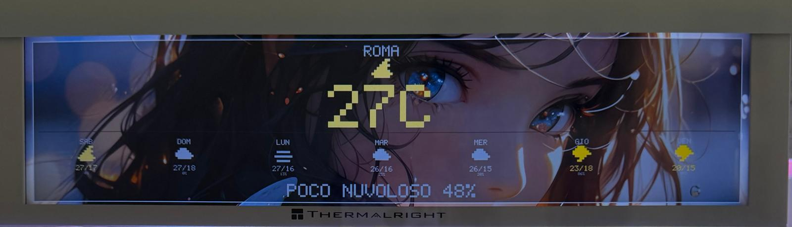

**A lightweight, open-source alternative to the official Thermalright TRCC
software.** Audio visualizer + system info monitor for the
**Thermalright Trofeo Vision 9.16 LCD** (USB `0416:5408`, "LY" protocol), the
**Trofeo Vision 11.3 LCD** (1920×400, same USB ID and protocol) and the
**Trofeo Vision 6.86 LCD** (1280×480, USB `0416:5302`) — see
[Supported panels](#supported-panels).

This project is a fork of [sukualam/trofeo-lcd](https://github.com/sukualam/trofeo-lcd),
whose driver was rewritten byte-for-byte from
[thermalright-trcc-linux](https://github.com/Lexonight1/thermalright-trcc-linux).
See **[NOTICE.md](./NOTICE.md)** for the full provenance and a summary of
what this fork adds on top of the original.

## What's new

**2.18.1 — the documentation is reorganised.** This README is now a short introduction; the rest is in the [docs](./docs/README.md) folder.

**2.18.0 — a clearer settings editor.** A search box finds any setting by its name, its key or
its hint; the sections are grouped by theme; *Settings I changed* lists what is written in your
file; after saving, a notice says which changes need a restart; and you can import a design from
the gallery.

**2.17.0 — share your design.** A new page of the settings editor takes a picture of what is on
your screen, copies the settings that make up the look (nothing personal) and opens the project's
gallery form on GitHub. See [the gallery](#the-gallery).

**2.16 — a fade between screens, and a fix for 6.86 screens that blink.** `screen_fade_ms = 600`
makes the old picture melt into the new one whenever the screen changes (off by default).
`hid_resend_ms = 1` keeps a Trofeo Vision 6.86 whose picture blinks or goes blank fed with data
(off by default).

Every version in detail: [docs/HISTORY.md](./docs/HISTORY.md) and the
[releases](https://github.com/haven80/trofeo-lcd-rs/releases).

## What it shows

The display **adapts automatically to what your computer is doing** — no
manual switching needed. The Trofeo LCD shows one of these views
depending on the moment:

**Idle** — audio is quiet, so the EQ bars are low and the top bar shows
system info: CPU usage & real-time frequency, RAM, uptime, clock and date.
Under the clock, a little self-playing **pixel-art game** runs.

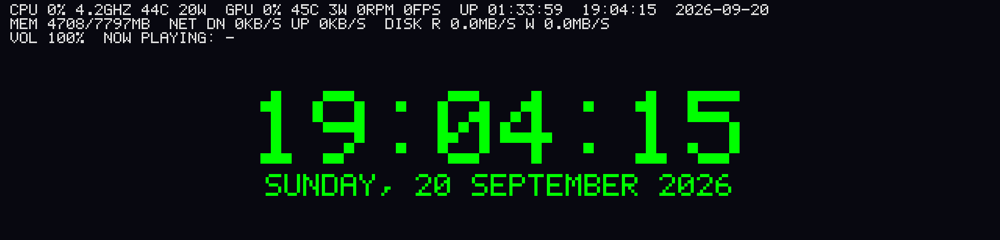

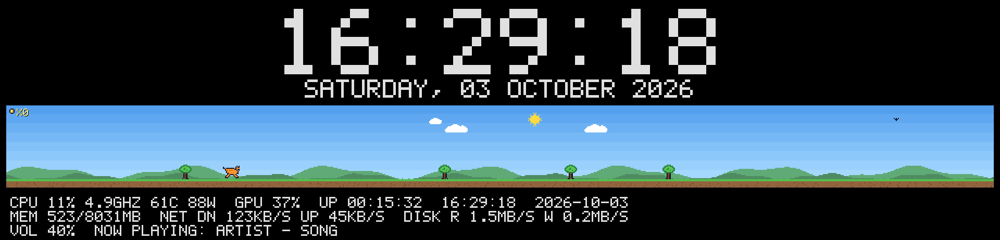

**Media** — a song is playing: the stripes follow the music, and the top bar
shows the now-playing track (title/artist/album from the media controls).
With `music_screen = true` the whole panel becomes a now-playing card, in one of nine designs.

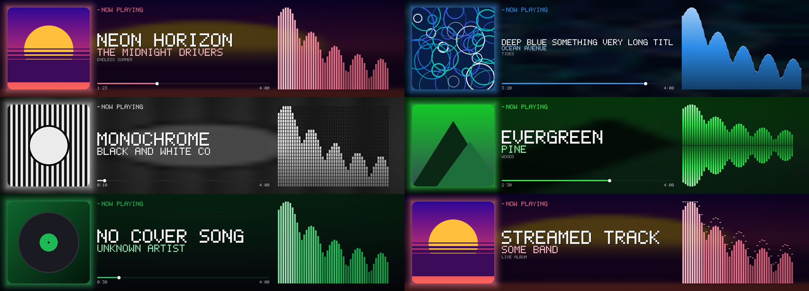

**Gaming** — a game is in the foreground: game info is detected and the
system status (CPU/GPU/RAM/temp) stays readable while playing. The gaming screen is optional
(`gaming_screen = false` keeps your own screen while you play); see the
[options guide](./OPTIONS_GUIDE.md#the-automatic-gaming-screen-applies-live).

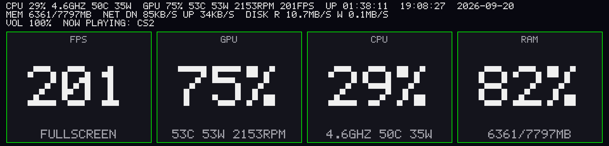

## Features

- **Audio visualizer**: 48 EQ bars from whatever is playing (WASAPI loopback on Windows,
  PulseAudio/PipeWire on Linux), with colour palettes and drawing styles.
- **System info**: CPU, GPU, RAM, temperatures, fan speeds, network, disk, clock and date,
  weather and a news ticker.
- **Full screens to choose from**: tiles, deck, cards, orbit, console, a digital picture frame,
  a Steam cover flow, nine gaming screens and nine music screens, rotating on a timer if you like.
- **Backgrounds**: an image, GIF or video, a solid colour or an animated effect (plasma, aurora,
  aquarium, network, globe, ...).
- **A settings editor** with a live preview, a search box, and a way to share your design.
- Fade between screens, 12-hour clock, start minimised in the tray, a DeepCool display driver,
  a second-monitor mode, and adaptive FPS to keep the load low.

The complete list: [docs/FEATURES.md](./docs/FEATURES.md).

## Install

**Windows.** Download the latest `trofeo-lcd-X.Y.Z-windows.zip` from the
[releases](https://github.com/haven80/trofeo-lcd-rs/releases), unzip it and run `trofeo_lcd.exe`.
Close the vendor program (TRCC) first: only one program can drive the screen. The zip has three
programs: `trofeo_lcd.exe` (the display), `trofeo_config.exe` (the settings editor) and
`trofeo_screen.exe` (second-monitor mode).

- Windows may flag the executables as a virus: it is a false positive. See
  [Troubleshooting](./docs/TROUBLESHOOTING.md).
- To read AMD CPU temperature and power, install [PawnIO](https://github.com/namazso/PawnIO) and run as
  Administrator. Intel CPUs, fans and a few other readings need LibreHardwareMonitor instead:
  [Which sensors you need and what to install](./docs/SENSORS.md).
- To start it with Windows: [Autostart on Windows](./docs/AUTOSTART.md).

**Linux.** Build it from source (below). It needs `pkg-config` and the PulseAudio headers to build,
and `playerctl` for song titles. For USB access without `sudo`, install `99-trofeo-lcd.rules`.

**From source** (any system with [Rust](https://www.rust-lang.org/tools/install)):

```bash
cargo build --release
./target/release/trofeo_lcd      # Windows: .\target\release\trofeo_lcd.exe
```

`cargo build --release` builds all three programs. The code is described in
[docs/DEVELOPMENT.md](./docs/DEVELOPMENT.md).

## Supported panels

| Panel | Picture size | Setting |
|---|---|---|
| Trofeo Vision 9.16 | 1920×462 | default |
| Trofeo Vision 11.3 | 1920×400 | recognised automatically, or `panel = trofeo-11.3` |
| Trofeo Vision 6.86 | 1280×480 | recognised automatically (USB `0416:5302`), or `panel = trofeo-6.86` |

The 6.86 and the other screens of its family have a screen test that finds the right orientation,
and an option for units whose picture blinks. Details: [docs/PANELS.md](./docs/PANELS.md).

## Settings editor (`trofeo_config`)

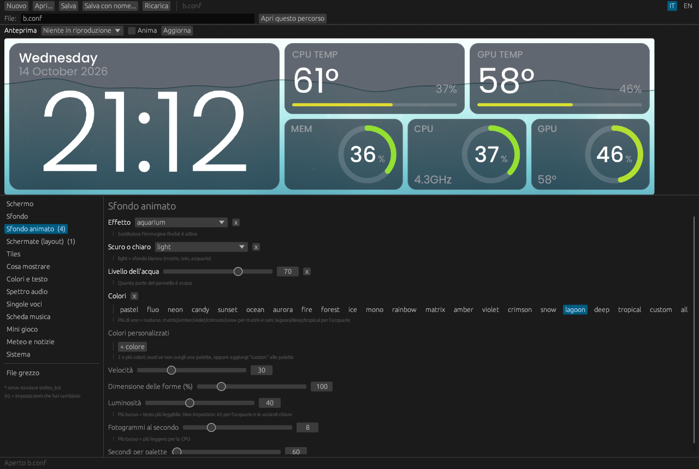

You don't need to edit `trofeo.conf` by hand: start `trofeo_config` (Windows: `trofeo_config.exe`,
in the same folder as `trofeo_lcd.exe`). It opens the `trofeo.conf` next to it, or the file you pass
as its first argument, and shows every setting in sections gathered by theme.


- **Search.** Type a word in the box at the top of the list (`12h`, `color`, `fade`, or a key
  name) and change the matching settings in place.
- **Live preview, drawn by the real program.** The picture at the top is made by `trofeo_lcd`
  itself, with sample data, so backgrounds, layouts, fonts and colors look exactly as they will on
  the LCD. It never touches the USB device, the audio or the sensors.
- **Only what you change is written.** The small `x` takes a setting out of the file again; `*`
  marks the ones that need a restart; **Settings I changed** gathers them all.
- **Your file stays yours.** Comments and lines the editor doesn't touch are kept, and the previous
  file is copied to `trofeo.conf.bak` the first time you save in each session.
- **The display follows by itself.** A running `trofeo_lcd` re-reads the file every second, so saved
  changes appear on the LCD without a restart.
- The window is in English or Italian: switch at the top right.

More in the [options guide](./OPTIONS_GUIDE.md#settings-editor-trofeo_config).

## The gallery

Show your screen to the other users: in the settings editor, open **Share your design**, take a
picture of your screen, check it, and the editor copies the settings of the look (never files,
folders, the weather city or sensors) and opens the gallery form on GitHub, where you drop the picture
and paste the settings. You post it yourself, with your own GitHub account; the program sends
nothing. Browse the designs:
[the gallery](https://github.com/haven80/trofeo-lcd-rs/issues?q=is%3Aissue+label%3Agallery).
To try someone else's design, paste its settings in **Share your design → Import a design**.

## Configuration

- **[Options guide](./OPTIONS_GUIDE.md)** — every setting, with defaults, valid values and examples.
- **[trofeo.conf.example](./trofeo.conf.example)** — a commented file to copy and edit.
- **[Configuration cookbook](./docs/CONFIGURATION.md)** — screens, backgrounds, fonts, tiles, weather,
  ticker, fans and sensors, one by one.
- **[Command-line options](./docs/COMMAND_LINE.md)** — the flags that only exist on the command line.
- **[Performance](./docs/PERFORMANCE.md)** — what each feature costs.

## Second monitor mode

Run **`trofeo_screen`** (instead of `trofeo_lcd` — they share the LCD, so don't run them together):

```bash
./target/release/trofeo_screen --list-displays    # list monitors
./target/release/trofeo_screen                    # stream to LCD
```

Requires a *Virtual Display Driver* (VDD) at 1920×462 — see
**[GUIDE_SECOND_MONITOR.md](./GUIDE_SECOND_MONITOR.md)**.

## Documentation

Everything that is not here is in [docs/](./docs/README.md): features, sensors, panels, the
configuration cookbook, command-line options, autostart, performance, troubleshooting, the version
history and the code structure.

## Credits

- Original project: [sukualam/trofeo-lcd](https://github.com/sukualam/trofeo-lcd)
  — this repository is a fork of it.
- USB protocol reverse-engineering:
  [thermalright-trcc-linux](https://github.com/Lexonight1/thermalright-trcc-linux)
  by Lexonight1.
- The smooth font (tiles layout and `font = smooth`) uses a subset of the [Poppins](https://github.com/itfoundry/Poppins) font
  (© The Poppins Project Authors, SIL Open Font License 1.1 — `assets/OFL.txt`).
- The settings editor is built with [egui / eframe](https://github.com/emilk/egui)
  (MIT or Apache-2.0) and, on Windows, [rfd](https://github.com/PolyMeilex/rfd) (MIT) for the file dialogs.
- See **[NOTICE.md](./NOTICE.md)** for what has changed in this fork.

## License

[GPL-3.0-or-later](./LICENSE) (follows the referenced upstream project).
