<h1 align="center">trofeo_lcd</h1>

<p align="center"><b>Beautiful screens for your Thermalright Trofeo Vision LCD.</b><br>
Twenty-two new designs and all the classic screens, bars that flow, your own layouts and themes — a lightweight, open-source alternative to TRCC.</p>

<h3 align="center">New designs <sub>(the bars of the animated ones really move)</sub></h3>

<table>
<tr>
<td width="50%" align="center">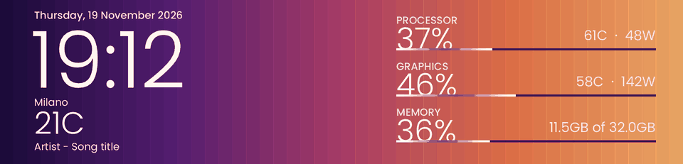<br><sub><code>layout = dusk</code></sub></td>
<td width="50%" align="center">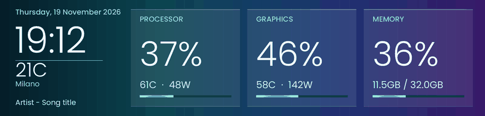<br><sub><code>layout = aurora</code></sub></td>
</tr>
<tr>
<td width="50%" align="center">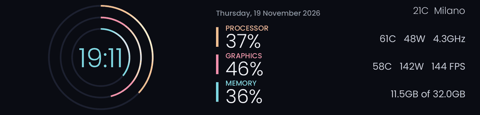<br><sub><code>layout = eclipse</code></sub></td>
<td width="50%" align="center">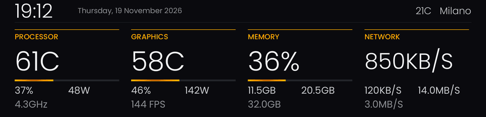<br><sub><code>layout = carbon</code></sub></td>
</tr>
<tr>
<td width="50%" align="center">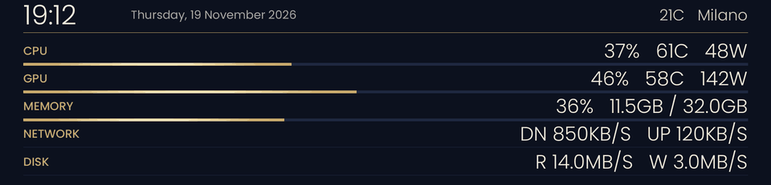<br><sub><code>layout = ledger</code></sub></td>
<td width="50%" align="center">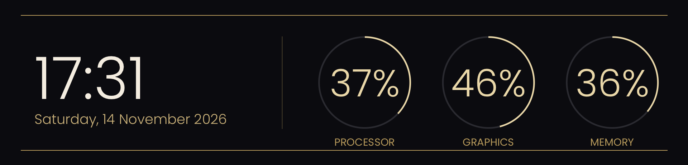<br><sub><code>layout = atelier</code></sub></td>
</tr>
<tr>
<td width="50%" align="center">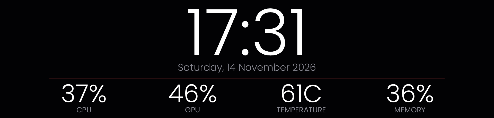<br><sub><code>layout = noir</code></sub></td>
<td width="50%" align="center">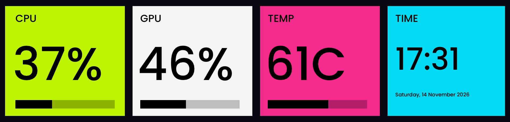<br><sub><code>layout = volt</code></sub></td>
</tr>
<tr>
<td width="50%" align="center">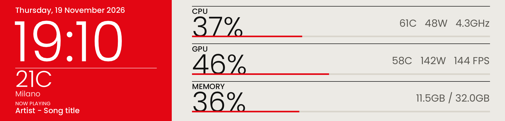<br><sub><code>layout = swiss</code></sub></td>
<td width="50%" align="center">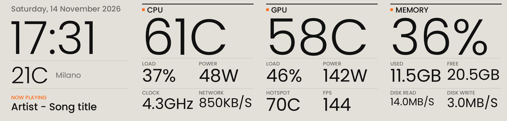<br><sub><code>layout = studio</code></sub></td>
</tr>
<tr>
<td width="50%" align="center">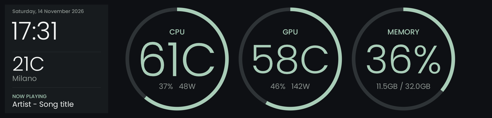<br><sub><code>layout = cluster</code></sub></td>
<td width="50%" align="center">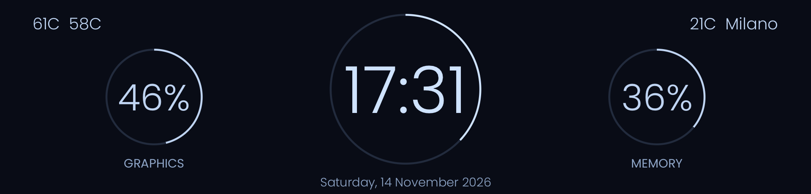<br><sub><code>layout = pearl</code></sub></td>
</tr>
</table>

<h3 align="center">Classic screens</h3>

<table>
<tr>
<td width="33%" align="center">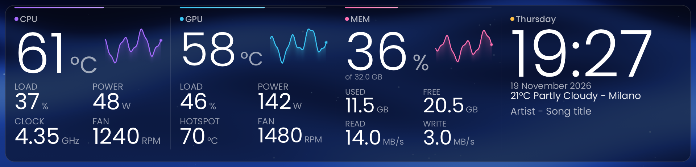<br><sub><code>layout = deck</code></sub></td>
<td width="33%" align="center">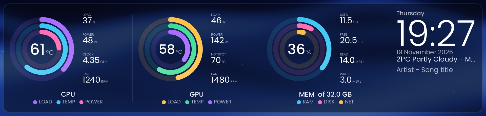<br><sub><code>layout = orbit</code></sub></td>
<td width="33%" align="center">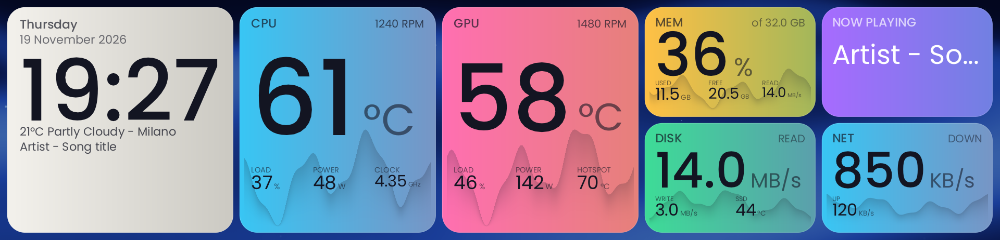<br><sub><code>layout = cards</code></sub></td>
</tr>
<tr>
<td width="33%" align="center">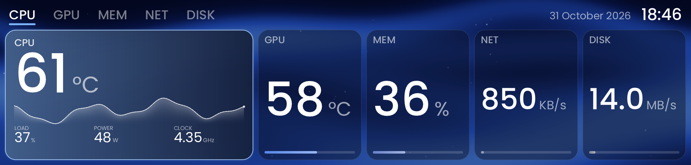<br><sub><code>layout = console</code></sub></td>
<td width="33%" align="center">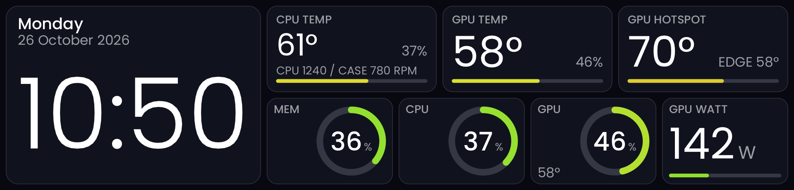<br><sub><code>layout = tiles</code></sub></td>
<td width="33%" align="center">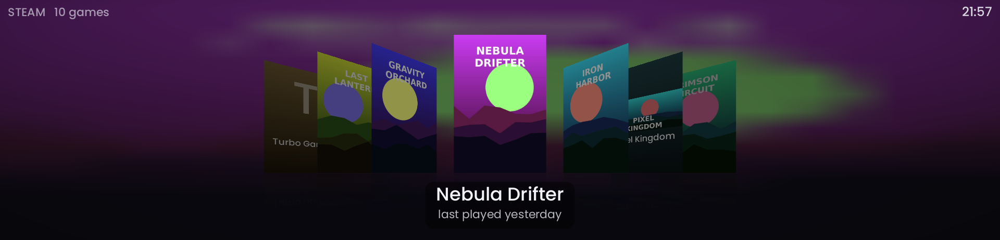<br><sub><code>layout = steam</code></sub></td>
</tr>
<tr>
<td width="33%" align="center">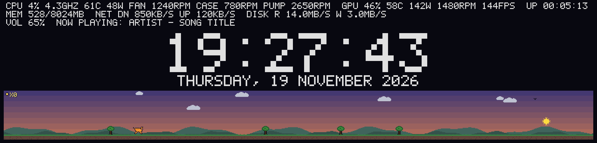<br><sub><code>layout = default</code></sub></td>
<td width="33%" align="center">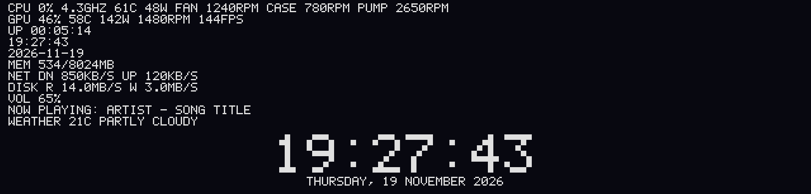<br><sub><code>layout = default2</code></sub></td>
<td width="33%" align="center">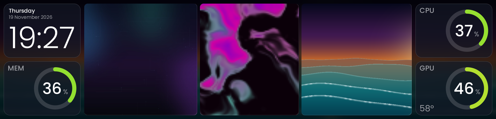<br><sub><code>layout = frame</code></sub></td>
</tr>
<tr>
<td width="33%" align="center">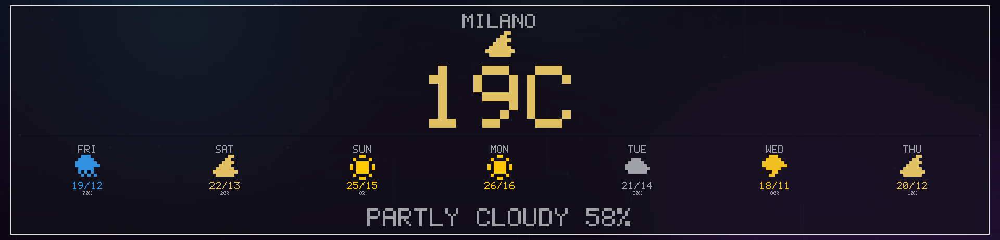<br><sub><code>layout = weather</code></sub></td>
<td width="33%" align="center">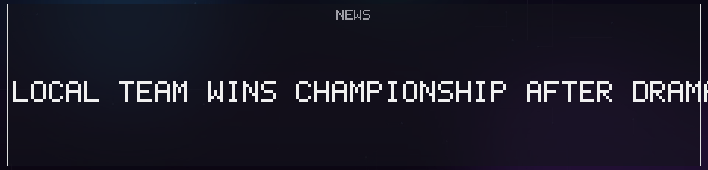<br><sub><code>layout = news</code></sub></td>
<td width="33%" align="center">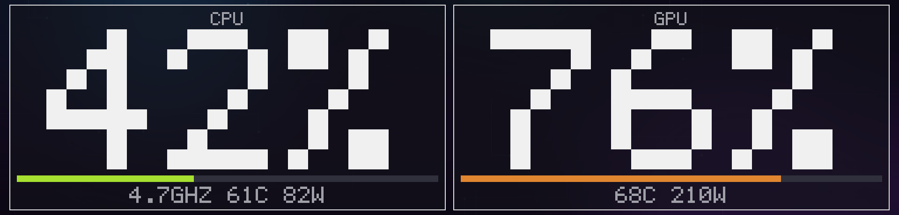<br><sub><code>layout = cpu-gpu</code></sub></td>
</tr>
<tr>
<td width="33%" align="center">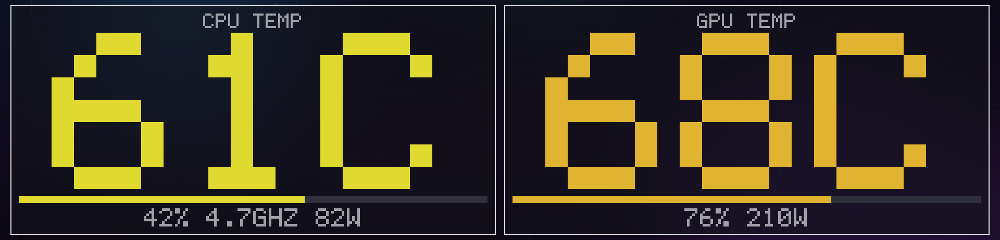<br><sub><code>layout = temps</code></sub></td>
<td width="33%" align="center">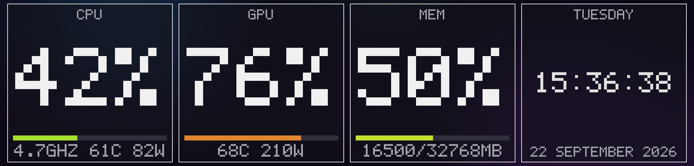<br><sub><code>layout = overview</code></sub></td>
<td width="33%" align="center">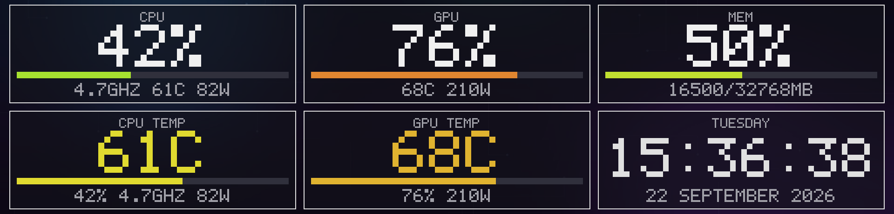<br><sub><code>layout = grid6</code></sub></td>
</tr>
<tr>
<td width="33%" align="center">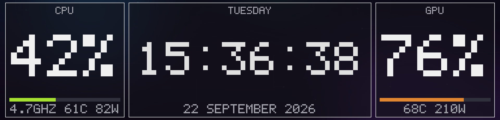<br><sub><code>layout = clock-center</code></sub></td>
<td width="33%" align="center">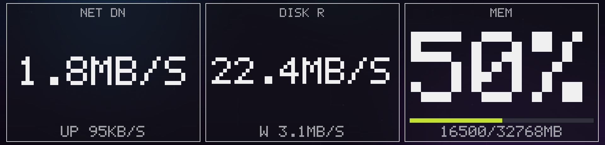<br><sub><code>layout = io</code></sub></td>
<td width="33%" align="center">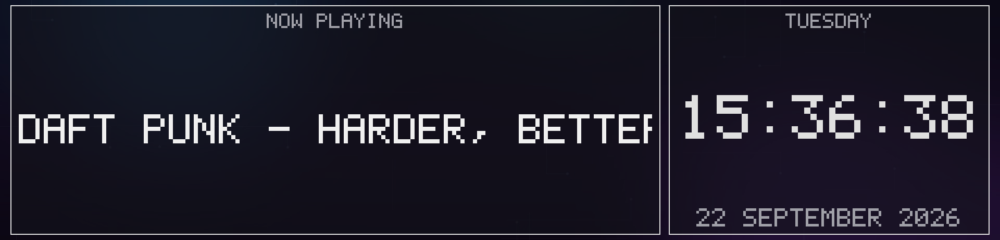<br><sub><code>layout = music</code></sub></td>
</tr>
<tr>
<td width="33%" align="center">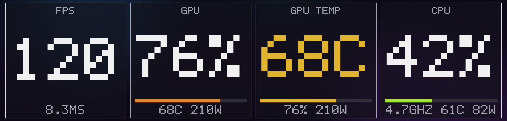<br><sub><code>layout = gaming</code></sub></td>
<td width="33%" align="center">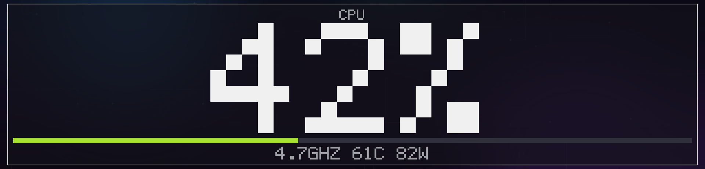<br><sub><code>layout = cpu</code></sub></td>
<td width="33%" align="center">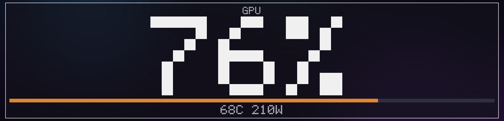<br><sub><code>layout = gpu</code></sub></td>
</tr>
</table>

<p align="center"><sub><b>43 screens</b> (22 new designs, 12 shown here, and 21 classics), plus nine for music and nine for games. Every one has a portrait version. <a href="#the-screens">Details and portrait versions ↓</a></sub></p>

<p align="center">
<a href="#the-screens">The screens</a> ·
<a href="#the-classic-screens">Classic screens</a> ·
<a href="#make-your-own">Make your own</a> ·
<a href="#install">Install</a> ·
<a href="#settings-editor-trofeo_config">Settings editor</a> ·
<a href="#the-gallery">Gallery</a> ·
<a href="./docs/README.md">Docs</a>
</p>

---

## The screens

Pick a look with one line in the configuration file (or in the settings editor, *Screens*) — nothing else to install:

```ini
layout = dusk
```

Every design has a **version for portrait panels**, chosen by itself, uses your **background and theme**, and follows your clock and weather settings. Rotate several: `layout = dusk:20, halo:10, aurora`. All of them are free layouts, so you can **copy one in the layout builder and make it yours** (see [Make your own](#make-your-own)). The full catalogue, with the portrait versions, is in **[docs/LAYOUTS.md](./docs/LAYOUTS.md)**.

### Flowing bars

Bars and rings whose gradient flows, all the time. `bar_animation = false` keeps them still.

<table>
<tr>
<td width="50%" valign="top"><br><b>Dusk</b> <sup>animated</sup><br>A sunset gradient from violet to orange, a giant light clock, three readings with a flowing bar.<br><code>layout = dusk</code></td>
<td width="50%" valign="top"><br><b>Aurora</b> <sup>animated</sup><br>Glass cards on a teal-to-violet gradient: processor, graphics, memory.<br><code>layout = aurora</code></td>
</tr>
<tr>
<td width="50%" valign="top"><br><b>Carbon</b> <sup>animated</sup><br>Matte black, amber lines, four columns: processor, graphics, memory, network.<br><code>layout = carbon</code></td>
<td width="50%" valign="top"><br><b>Eclipse</b> <sup>animated</sup><br>Three concentric rings that shimmer, the clock in the middle.<br><code>layout = eclipse</code></td>
</tr>
<tr>
<td width="50%" valign="top"><br><b>Ledger</b> <sup>animated</sup><br>A navy ledger with gold lines, one row per device.<br><code>layout = ledger</code></td>
<td width="50%"></td>
</tr>
</table>

### Elegant and calm

A light, thin typeface, a lot of room, one or two colours.

<table>
<tr>
<td width="50%" valign="top"><br><b>Atelier</b><br>Ivory and champagne gold on charcoal: a light clock, hairlines, three fine rings.<br><code>layout = atelier</code></td>
<td width="50%" valign="top"><br><b>Noir</b><br>White on black with one red hairline: a huge light clock and four quiet figures.<br><code>layout = noir</code></td>
</tr>
<tr>
<td width="50%" valign="top"><br><b>Pearl</b><br>Cool and airy: the clock inside a fine ring, a ring on each side.<br><code>layout = pearl</code></td>
<td width="50%" valign="top">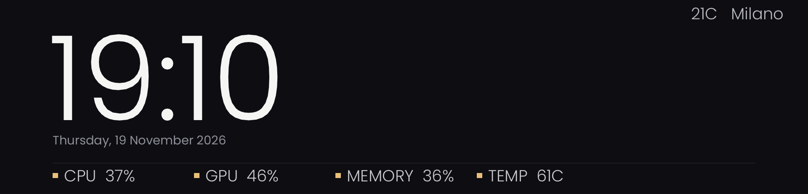<br><b>Haiku</b><br>A huge light clock, lots of space, one line of readings.<br><code>layout = haiku</code></td>
</tr>
<tr>
<td width="50%" valign="top">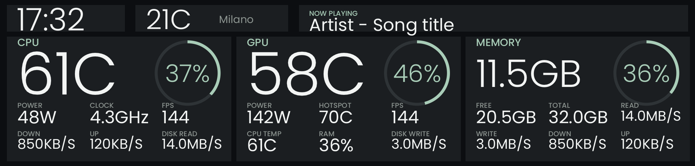<br><b>Mineral</b><br>Dark cards in sage green, a ring and six readings on each.<br><code>layout = mineral</code></td>
<td width="50%" valign="top"><br><b>Cluster</b><br>A car instrument cluster: three big dials, the clock and the song on the side.<br><code>layout = cluster</code></td>
</tr>
</table>

### Light pages

For a bright desk or a white case.

<table>
<tr>
<td width="50%" valign="top"><br><b>Studio</b><br>Paper and ink: a light spec sheet, black figures, one orange accent.<br><code>layout = studio</code></td>
<td width="50%" valign="top"><br><b>Swiss</b><br>A red block with a huge clock, big black figures and thin bars on a light page.<br><code>layout = swiss</code></td>
</tr>
<tr>
<td width="50%" valign="top">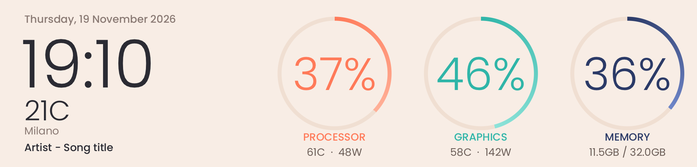<br><b>Peach</b><br>A warm light page with three gradient rings.<br><code>layout = peach</code></td>
<td width="50%"></td>
</tr>
</table>

### Loud

Big colour, giant figures.

<table>
<tr>
<td width="50%" valign="top"><br><b>Volt</b><br>Four loud colour blocks with giant figures.<br><code>layout = volt</code></td>
<td width="50%" valign="top">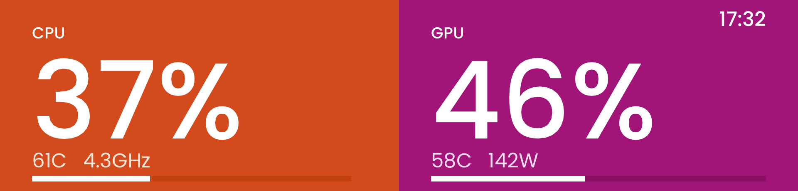<br><b>Blaze</b><br>CPU in orange, GPU in magenta, giant figures.<br><code>layout = blaze</code></td>
</tr>
<tr>
<td width="50%" valign="top">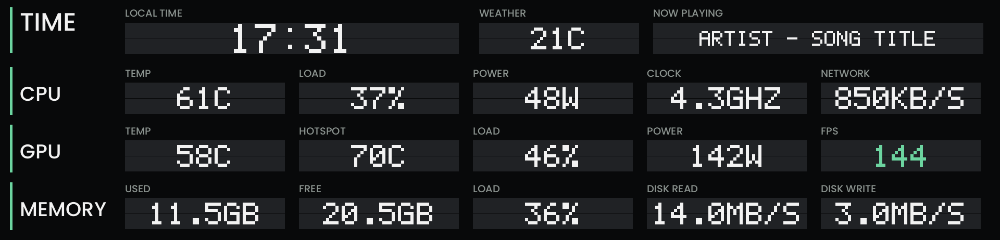<br><b>Board</b><br>An airport departure board: every number on a tile.<br><code>layout = board</code></td>
<td width="50%"></td>
</tr>
</table>

### Pixel classics

The 5×7 pixel font of the original program.

<table>
<tr>
<td width="50%" valign="top">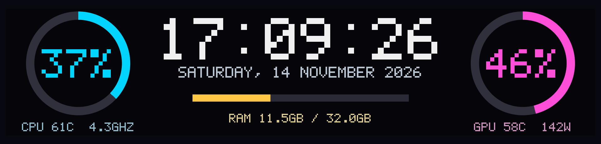<br><b>Halo</b><br>Two big rings for CPU and GPU, the clock in the middle, memory below.<br><code>layout = halo</code></td>
<td width="50%" valign="top">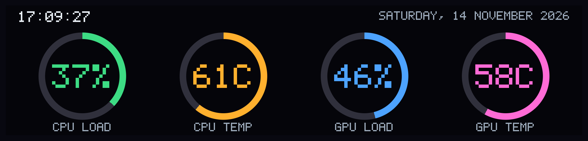<br><b>Gauges</b><br>Four dials: load and temperature of CPU and GPU.<br><code>layout = gauges</code></td>
</tr>
<tr>
<td width="50%" valign="top">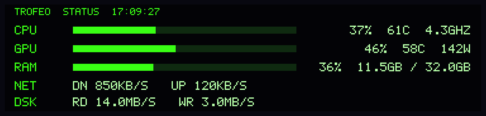<br><b>Terminal</b><br>Green-on-black readout, one line per device.<br><code>layout = terminal</code></td>
<td width="50%" valign="top">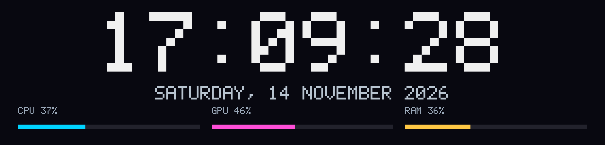<br><b>Horizon</b><br>A huge clock and three thin lines of load.<br><code>layout = horizon</code></td>
</tr>
<tr>
<td width="50%" valign="top">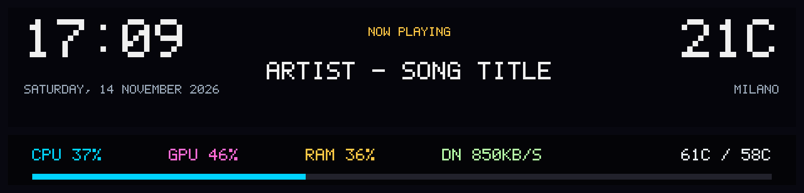<br><b>Ribbon</b><br>Clock, song and weather above a ribbon of readings.<br><code>layout = ribbon</code></td>
<td width="50%"></td>
</tr>
</table>

### And on a portrait panel

<p align="center">
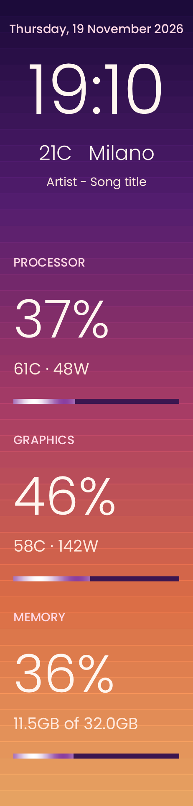 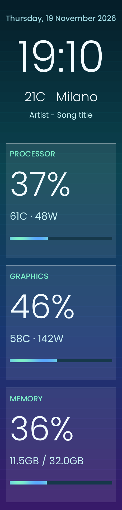 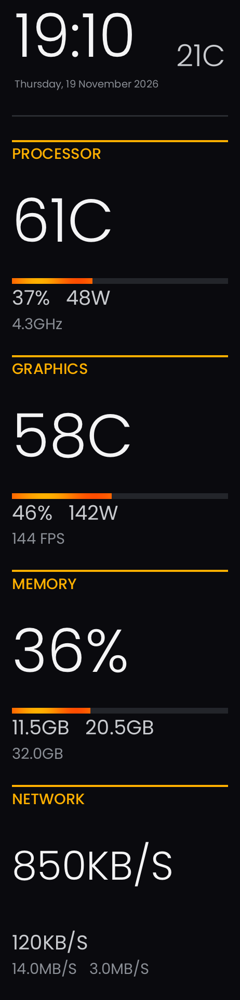 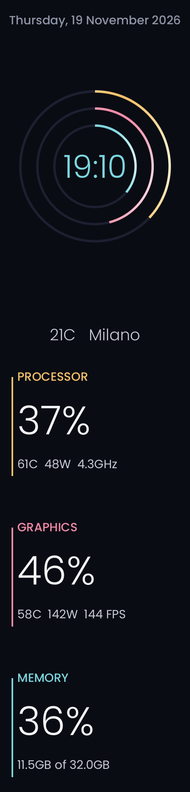 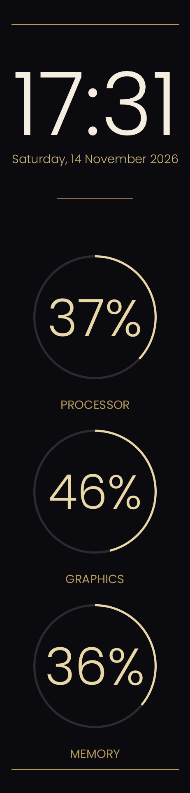 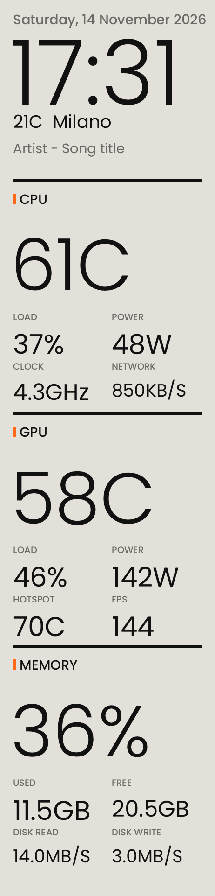 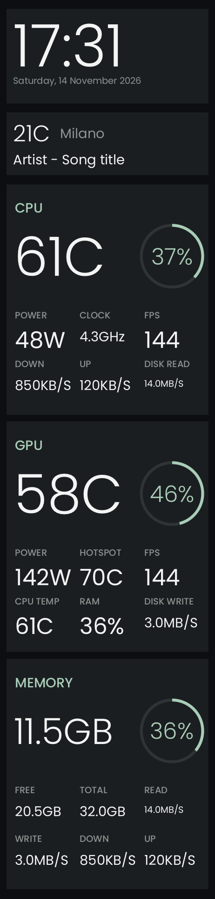 
</p>

---

## The classic screens

The screens the program has always had — and they keep getting better. They are chosen with `layout = <name>`, like the new designs above, and all of them work on portrait panels too.

### Standard screens

The original look: status lines on top, a spectrum while music plays, a big clock when idle, and the pixel game under it.

<table>
<tr>
<td width="50%" valign="top"><br><b>Default</b><br>Status lines on top, spectrum with music, large clock when idle. <a href="docs/CONFIGURATION.md#what-to-show-where-and-colors">More</a><br><code>layout = default</code></td>
<td width="50%" valign="top"><br><b>Default 2</b><br>Like default, but every item has its own size, position and colour. <a href="docs/CONFIGURATION.md#what-to-show-where-and-colors">More</a><br><code>layout = default2</code></td>
</tr>
</table>

### Instrument screens

Live gauges and graphs of the last minutes. Choose the parts with `deck = cpu, gpu, ram, clock` and the like.

<table>
<tr>
<td width="50%" valign="top"><br><b>Deck</b><br>Instrument columns: a gauge, a big value, a graph and four readings per column. <a href="docs/CONFIGURATION.md#deck-cards-orbit-and-console">More</a><br><code>layout = deck</code></td>
<td width="50%" valign="top"><br><b>Orbit</b><br>Concentric rings per device with the readings beside them. <a href="docs/CONFIGURATION.md#deck-cards-orbit-and-console">More</a><br><code>layout = orbit</code></td>
</tr>
<tr>
<td width="50%" valign="top"><br><b>Cards</b><br>Colourful cards in a mosaic, each with a ghost graph of its own history. <a href="docs/CONFIGURATION.md#deck-cards-orbit-and-console">More</a><br><code>layout = cards</code></td>
<td width="50%" valign="top"><br><b>Console</b><br>A bar with the names and the clock over a row of tiles; the one in focus grows and shows the details. <a href="docs/CONFIGURATION.md#deck-cards-orbit-and-console">More</a><br><code>layout = console</code></td>
</tr>
<tr>
<td width="50%" valign="top"><br><b>Tiles</b><br>Rounded glass tiles with big values, bars and rings, chosen one by one. <a href="docs/CONFIGURATION.md#tiles-layout-glass-dashboard">More</a><br><code>layout = tiles</code></td>
<td width="50%"></td>
</tr>
</table>

### One thing, large

When you only care about a few numbers.

<table>
<tr>
<td width="50%" valign="top"><br><b>CPU and GPU</b><br>CPU and GPU side by side: usage, temperature and watts.<br><code>layout = cpu-gpu</code></td>
<td width="50%" valign="top"><br><b>Temperatures</b><br>CPU and GPU temperatures, large, with a bar.<br><code>layout = temps</code></td>
</tr>
<tr>
<td width="50%" valign="top"><br><b>Overview</b><br>CPU, GPU, RAM and clock.<br><code>layout = overview</code></td>
<td width="50%" valign="top"><br><b>Grid 6</b><br>A 3×2 grid: CPU and GPU usage and temperature, RAM, clock.<br><code>layout = grid6</code></td>
</tr>
<tr>
<td width="50%" valign="top"><br><b>Clock centre</b><br>The clock in the middle, CPU on the left and GPU on the right.<br><code>layout = clock-center</code></td>
<td width="50%" valign="top"><br><b>Input / output</b><br>Network, disk and RAM.<br><code>layout = io</code></td>
</tr>
<tr>
<td width="50%" valign="top"><br><b>CPU</b><br>CPU only, large: usage, temperature, frequency, watts.<br><code>layout = cpu</code></td>
<td width="50%" valign="top"><br><b>GPU</b><br>GPU only, large: usage, temperature, watts.<br><code>layout = gpu</code></td>
</tr>
<tr>
<td width="50%" valign="top"><br><b>Gaming</b><br>FPS, GPU, GPU temperature and CPU.<br><code>layout = gaming</code></td>
<td width="50%" valign="top"><br><b>Music</b><br>The song that is playing, large, and the clock. <a href="OPTIONS_GUIDE.md#music-screen-now-playing-card">More</a><br><code>layout = music</code></td>
</tr>
</table>

### Weather, news, pictures, games

Screens for something other than the PC.

<table>
<tr>
<td width="50%" valign="top"><br><b>Weather</b><br>Current weather, large: temperature, condition icon and city. <a href="docs/CONFIGURATION.md#weather">More</a><br><code>layout = weather</code></td>
<td width="50%" valign="top"><br><b>News</b><br>The latest headlines, scrolling. <a href="docs/CONFIGURATION.md#ticker-news-headlines-or-any-custom-feed">More</a><br><code>layout = news</code></td>
</tr>
<tr>
<td width="50%" valign="top"><br><b>Digital frame</b><br>A collage of the pictures of a folder, with system info at the sides. <a href="docs/CONFIGURATION.md#digital-frame-picture-collage">More</a><br><code>layout = frame</code></td>
<td width="50%" valign="top"><br><b>Steam cover flow</b><br>The box art of your installed games sliding by with reflections. <a href="docs/CONFIGURATION.md#steam-cover-flow">More</a><br><code>layout = steam</code></td>
</tr>
</table>

### Music screens

While a song plays, the whole panel can become a now-playing card (`music_screen = true`). Nine designs, chosen with `music_layout`: [all the settings](OPTIONS_GUIDE.md#music-screen-now-playing-card).

<table>
<tr>
<td width="25%" valign="top"><br><b>Vinyl</b></td>
<td width="25%" valign="top"><br><b>Poster</b></td>
<td width="25%" valign="top"><br><b>Radial</b></td>
<td width="25%" valign="top"><br><b>Wave</b></td>
</tr>
<tr>
<td width="25%" valign="top"><br><b>Cassette</b></td>
<td width="25%" valign="top"><br><b>Equalizer</b></td>
<td width="25%" valign="top"><br><b>Minimal</b></td>
<td width="25%" valign="top"><br><b>VU</b></td>
</tr>
</table>

### Gaming screens

While a game runs, the LCD switches to a screen made for it. Nine designs, chosen with `gaming_layout`, each drawn for landscape and portrait: [all the settings](docs/CONFIGURATION.md#gaming-screens).

<table>
<tr>
<td width="33%" valign="top"><br><b>Arena</b></td>
<td width="33%" valign="top"><br><b>Cockpit</b></td>
<td width="33%" valign="top"><br><b>Neon</b></td>
</tr>
<tr>
<td width="33%" valign="top"><br><b>Quest</b></td>
<td width="33%" valign="top"><br><b>Arcade</b></td>
<td width="33%" valign="top"><br><b>Classic</b></td>
</tr>
<tr>
<td width="33%" valign="top"><br><b>Tactical</b></td>
<td width="33%" valign="top"><br><b>Telemetry</b></td>
<td width="33%" valign="top"><br><b>Zen</b></td>
</tr>
</table>

---

## Make your own

The **settings editor** (`trofeo_config`) is where you make the screen yours, without touching a text file.

<table>
<tr>
<td width="50%" valign="top"><br><b>Layout builder</b><br>Drag texts with live values, bars, rings, rectangles and pictures anywhere and see them drawn by the real program as you move them. Every change is saved at once; undo and redo work. <i>Copy a built-in design</i> starts you from any screen above.</td>
<td width="50%" valign="top"><br><b>Themes</b><br><code>theme = ocean</code> gives a whole look in one line (eight come with the program). <i>Share your design → Your themes</i> saves your own, copies it as text, attaches it to a gallery post and imports other people's.</td>
</tr>
</table>

A layout is a plain text file, `layouts/<name>.layout`, one element per line — positions in % of the screen, so it fits any panel:

```ini
rect  x=0 y=0 w=100 h=100 color=#101820 opacity=80
text  x=5  y=45 anchor=l size=17 font=smooth weight=light text="{time_short}"
text  x=5  y=72 anchor=l size=4  font=smooth color=#9AA8B8 text="{date}"
ring  x=70 y=50 anchor=c w=14 h=60 value=cpu text="{cpu}" font=smooth color=#00D4FF color2=#7CF0C9 flow=4 thick=6
bar   x=55 y=88 w=40 h=2 value=gpu color=#FF4FD8 color2=#FFC845 flow=3
```

Texts with live values (`{cpu}`, `{gpu_temp}`, `{song}`, `{weather_temp}` …), bars, rings (with gradients that can flow), rectangles and pictures; a thin smooth font or the pixel font; the file is read again every second, so a saved change shows at once. Everything is explained in the [options guide](./OPTIONS_GUIDE.md#free-layouts--design-your-own-screen). Made something you like? **Share it in [the gallery](#the-gallery).**

---

## What's new

**2.25.0 — eight more screens and bars that flow.** `swiss`, `dusk`, `aurora`, `carbon`, `eclipse`, `ledger`, `haiku`, `peach`; `color2` and `flow` give bars and rings a gradient that travels (`bar_animation = false` keeps them still).<br>
**2.24.0 — nine screens in a thin font.** `atelier`, `noir`, `pearl`, `volt`, `blaze`, `studio`, `board`, `mineral`, `cluster`; free layouts can use `font=smooth weight=light`.<br>
**2.23.0 — five screens.** `halo`, `gauges`, `terminal`, `horizon`, `ribbon`; *Copy a built-in design* in the builder.<br>
**2.22.0 — free layouts.** Your own screen as a text file or with the visual builder.<br>
**2.21.0 — profiles** (a set of settings per game or situation), **2.20.0 — your own themes**, **2.19.0 — themes, night mode, alerts**.

Every version in detail: [docs/HISTORY.md](./docs/HISTORY.md) and the [releases](https://github.com/haven80/trofeo-lcd-rs/releases).

---

## About

**A lightweight, open-source alternative to the official Thermalright TRCC software.** Audio visualizer + system info monitor for the **Thermalright Trofeo Vision 9.16 LCD** (USB `0416:5408`, "LY" protocol), the **Trofeo Vision 11.3 LCD** (1920×400, same USB ID and protocol) and the **Trofeo Vision 6.86 LCD** (1280×480, USB `0416:5302`) — see [Supported panels](#supported-panels).

This project is a fork of [sukualam/trofeo-lcd](https://github.com/sukualam/trofeo-lcd), whose driver was rewritten byte-for-byte from [thermalright-trcc-linux](https://github.com/Lexonight1/thermalright-trcc-linux). See **[NOTICE.md](./NOTICE.md)** for the full provenance and a summary of what this fork adds on top of the original.

The photos below are the real thing, on a real panel:

<table>
<tr>
<td width="33%"></td>
<td width="33%"></td>
<td width="33%"></td>
</tr>
<tr>
<td width="33%"></td>
<td width="33%"></td>
<td width="33%"></td>
</tr>
</table>

---

## What it shows

The display **adapts automatically to what your computer is doing** — no
manual switching needed. The Trofeo LCD shows one of these views
depending on the moment:

**Idle** — audio is quiet, so the EQ bars are low and the top bar shows
system info: CPU usage & real-time frequency, RAM, uptime, clock and date.
Under the clock, a little self-playing **pixel-art game** runs.


**Media** — a song is playing: the stripes follow the music, and the top bar
shows the now-playing track (title/artist/album from the media controls).
With `music_screen = true` the whole panel becomes a now-playing card, in one of nine designs.


**Gaming** — a game is in the foreground: game info is detected and the
system status (CPU/GPU/RAM/temp) stays readable while playing. The gaming screen is optional
(`gaming_screen = false` keeps your own screen while you play); see the
[options guide](./OPTIONS_GUIDE.md#the-automatic-gaming-screen-applies-live).


## Features

- **Audio visualizer**: 48 EQ bars from whatever is playing (WASAPI loopback on Windows,
  PulseAudio/PipeWire on Linux), with colour palettes and drawing styles.
- **System info**: CPU, GPU, RAM, temperatures, fan speeds, network, disk, clock and date,
  weather and a news ticker.
- **Full screens to choose from**: tiles, deck, cards, orbit, console, a digital picture frame,
  a Steam cover flow, nine gaming screens and nine music screens, rotating on a timer if you like.
- **Backgrounds**: an image, GIF or video, a solid colour or an animated effect (plasma, aurora,
  aquarium, network, globe, ...).
- **A settings editor** with a live preview, a search box, and a way to share your design.
- Fade between screens, 12-hour clock, start minimised in the tray, a DeepCool display driver,
  a second-monitor mode, and adaptive FPS to keep the load low.

The complete list: [docs/FEATURES.md](./docs/FEATURES.md).

## Install

**Windows.** Download the latest `trofeo-lcd-X.Y.Z-windows.zip` from the
[releases](https://github.com/haven80/trofeo-lcd-rs/releases), unzip it and run `trofeo_lcd.exe`.
Close the vendor program (TRCC) first: only one program can drive the screen. The zip has three
programs: `trofeo_lcd.exe` (the display), `trofeo_config.exe` (the settings editor) and
`trofeo_screen.exe` (second-monitor mode).

- Windows may flag the executables as a virus: it is a false positive. See
  [Troubleshooting](./docs/TROUBLESHOOTING.md).
- To read AMD CPU temperature and power, install [PawnIO](https://github.com/namazso/PawnIO) and run as
  Administrator. Intel CPUs, fans and a few other readings need LibreHardwareMonitor instead:
  [Which sensors you need and what to install](./docs/SENSORS.md).
- To start it with Windows: [Autostart on Windows](./docs/AUTOSTART.md).

**Linux.** Build it from source (below). It needs `pkg-config` and the PulseAudio headers to build,
and `playerctl` for song titles. For USB access without `sudo`, install `99-trofeo-lcd.rules`.

**From source** (any system with [Rust](https://www.rust-lang.org/tools/install)):

```bash
cargo build --release
./target/release/trofeo_lcd      # Windows: .\target\release\trofeo_lcd.exe
```

`cargo build --release` builds all three programs. The code is described in
[docs/DEVELOPMENT.md](./docs/DEVELOPMENT.md).

## Supported panels

| Panel | Picture size | Setting |
|---|---|---|
| Trofeo Vision 9.16 | 1920×462 | default |
| Trofeo Vision 11.3 | 1920×400 | recognised automatically, or `panel = trofeo-11.3` |
| Trofeo Vision 6.86 | 1280×480 | recognised automatically (USB `0416:5302`), or `panel = trofeo-6.86` |

The 6.86 and the other screens of its family have a screen test that finds the right orientation,
and an option for units whose picture blinks. Details: [docs/PANELS.md](./docs/PANELS.md).

## Settings editor (`trofeo_config`)


You don't need to edit `trofeo.conf` by hand: start `trofeo_config` (Windows: `trofeo_config.exe`,
in the same folder as `trofeo_lcd.exe`). It opens the `trofeo.conf` next to it, or the file you pass
as its first argument, and shows every setting in sections gathered by theme.


- **Search.** Type a word in the box at the top of the list (`12h`, `color`, `fade`, or a key
  name) and change the matching settings in place.
- **Live preview, drawn by the real program.** The picture at the top is made by `trofeo_lcd`
  itself, with sample data, so backgrounds, layouts, fonts and colors look exactly as they will on
  the LCD. It never touches the USB device, the audio or the sensors.
- **Only what you change is written.** The small `x` takes a setting out of the file again; `*`
  marks the ones that need a restart; **Settings I changed** gathers them all.
- **Your file stays yours.** Comments and lines the editor doesn't touch are kept, and the previous
  file is copied to `trofeo.conf.bak` the first time you save in each session.
- **The display follows by itself.** A running `trofeo_lcd` re-reads the file every second, so saved
  changes appear on the LCD without a restart.
- The window is in English or Italian: switch at the top right.

More in the [options guide](./OPTIONS_GUIDE.md#settings-editor-trofeo_config).

## The gallery

Show your screen to the other users: in the settings editor, open **Share your design**, take a
picture of your screen, check it, and the editor copies the settings of the look (never files,
folders, the weather city or sensors) and opens the gallery form on GitHub, where you drop the picture
and paste the settings. You post it yourself, with your own GitHub account; the program sends
nothing. Browse the designs:
[the gallery](https://github.com/haven80/trofeo-lcd-rs/issues?q=is%3Aissue+label%3Agallery).
To try someone else's design, paste its settings in **Share your design → Import a design**.

## Configuration

- **[Options guide](./OPTIONS_GUIDE.md)** — every setting, with defaults, valid values and examples.
- **[trofeo.conf.example](./trofeo.conf.example)** — a commented file to copy and edit.
- **[Configuration cookbook](./docs/CONFIGURATION.md)** — screens, backgrounds, fonts, tiles, weather,
  ticker, fans and sensors, one by one.
- **[Command-line options](./docs/COMMAND_LINE.md)** — the flags that only exist on the command line.
- **[Performance](./docs/PERFORMANCE.md)** — what each feature costs.

## Second monitor mode

Run **`trofeo_screen`** (instead of `trofeo_lcd` — they share the LCD, so don't run them together):

```bash
./target/release/trofeo_screen --list-displays    # list monitors
./target/release/trofeo_screen                    # stream to LCD
```

Requires a *Virtual Display Driver* (VDD) at 1920×462 — see
**[GUIDE_SECOND_MONITOR.md](./GUIDE_SECOND_MONITOR.md)**.

## Documentation

Everything that is not here is in [docs/](./docs/README.md): features, sensors, panels, the
configuration cookbook, command-line options, autostart, performance, troubleshooting, the version
history and the code structure.

## Credits

- Original project: [sukualam/trofeo-lcd](https://github.com/sukualam/trofeo-lcd)
  — this repository is a fork of it.
- USB protocol reverse-engineering:
  [thermalright-trcc-linux](https://github.com/Lexonight1/thermalright-trcc-linux)
  by Lexonight1.
- The smooth font (tiles layout and `font = smooth`) uses a subset of the [Poppins](https://github.com/itfoundry/Poppins) font
  (© The Poppins Project Authors, SIL Open Font License 1.1 — `assets/OFL.txt`).
- The settings editor is built with [egui / eframe](https://github.com/emilk/egui)
  (MIT or Apache-2.0) and, on Windows, [rfd](https://github.com/PolyMeilex/rfd) (MIT) for the file dialogs.
- See **[NOTICE.md](./NOTICE.md)** for what has changed in this fork.

## License

[GPL-3.0-or-later](./LICENSE) (follows the referenced upstream project).
