# trofeo_lcd
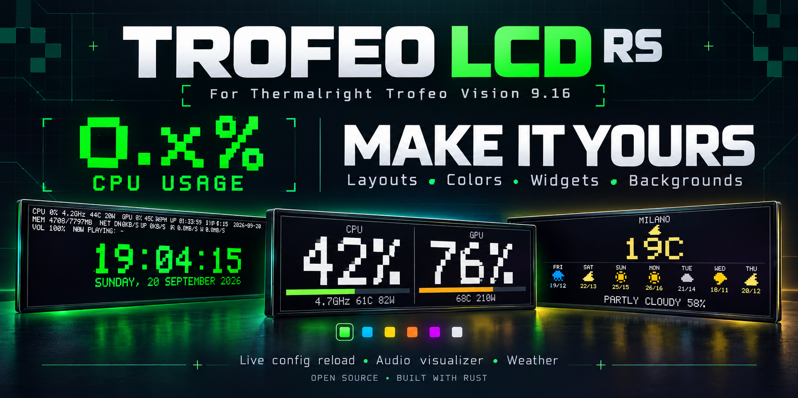
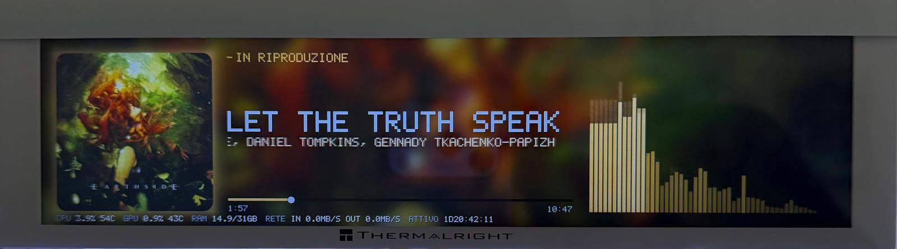
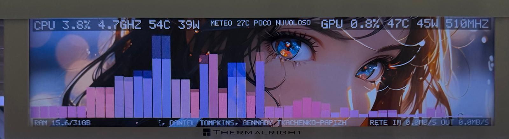
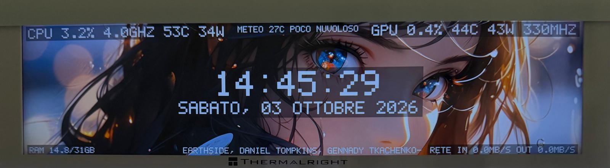
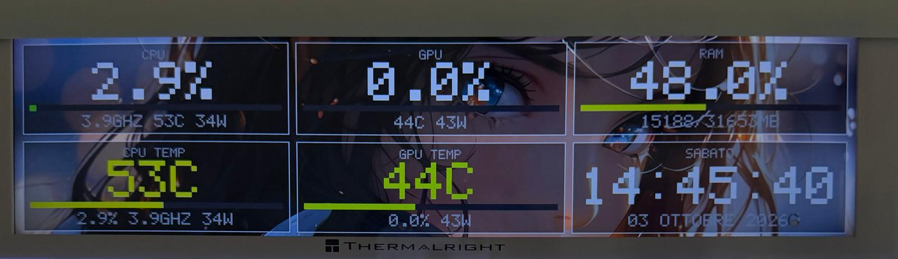
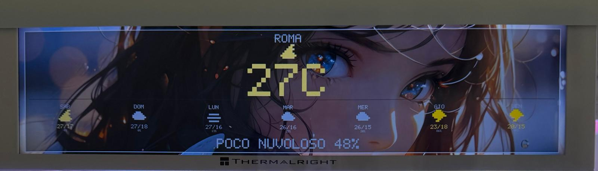


**A lightweight, open-source alternative to the official Thermalright TRCC
software.** Audio visualizer + system info monitor for the
**Thermalright Trofeo Vision 9.16 LCD** (USB `0416:5408`, "LY" protocol) and
the **Trofeo Vision 11.3 LCD** (1920×400, same USB ID and protocol — see
[Supported panels](#supported-panels)).

This project is a fork of [sukualam/trofeo-lcd](https://github.com/sukualam/trofeo-lcd),
whose driver was rewritten byte-for-byte from
[thermalright-trcc-linux](https://github.com/Lexonight1/thermalright-trcc-linux).
See **[NOTICE.md](./NOTICE.md)** for the full provenance and a summary of
what this fork adds on top of the original.

The display **adapts automatically to what your computer is doing** — no
manual switching needed. The Trofeo LCD shows one of these views below
depending on the moment:

**Idle** — audio is quiet, so the EQ bars are low and the top bar shows
system info: CPU usage & real-time frequency, RAM, uptime, clock and date.
Under the clock, a little self-playing **pixel-art game** runs
(see [Pixel game](#pixel-game-under-the-clock)).

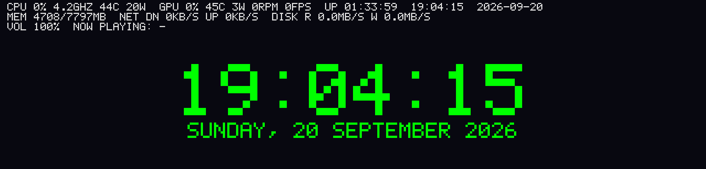

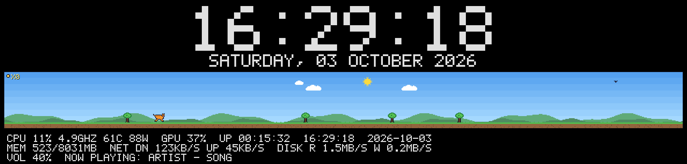

**Media** — a song is playing: the stripes follow the music, and the top bar
shows the now-playing track (title/artist/album from the media controls).
With `music_screen = true` the whole panel becomes a Spotify-style now-playing card.
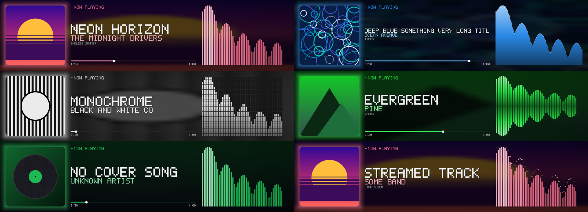


**Gaming** — a game is in the foreground: game info is detected and the
system status (CPU/GPU/RAM/temp) stays readable while playing.

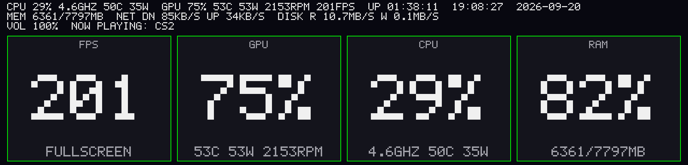

**Don't like editing text files?** Start **`trofeo_config`**, the graphical
[settings editor](#settings-editor-trofeo_config): menus, sliders and color pickers for every
option, and a live preview of the display drawn by the real program.

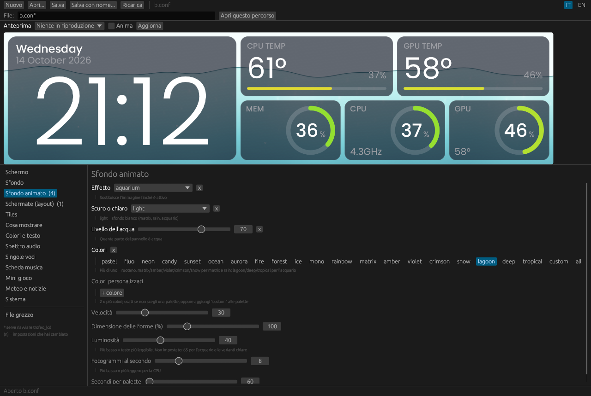

## Features

- EQ bars (48) from currently playing audio (WASAPI loopback on Windows,
  PulseAudio/PipeWire on Linux), colored green→yellow→red — or any of 9 color
  palettes and 5 drawing styles.
- System info: CPU %, real-time CPU frequency, RAM, uptime, clock & date.
- **Settings editor** (`trofeo_config`): a small graphical program to create and edit
  `trofeo.conf` — every option in sections, with a **live preview drawn by the real
  program**. It only edits the file: it is not needed (and not in memory) while the display
  runs (see [Settings editor](#settings-editor-trofeo_config)).
- **Music screen**: a Spotify-style now-playing card (album cover, artist/title,
  progress bar, spectrum, colors taken from the cover).
- **Two fonts for every text**: the classic blocky pixel font, or smooth anti-aliased
  **Poppins** in all screens (`font = smooth`) — see [Font](#font).
- **Pixel game** under the clock: a self-playing pixel-art platformer (a knight
  or a cat) that reacts to CPU load, music, network/disk bursts, the hour, and
  the real weather and time of day.
- **Tiles layout**: a modern glass dashboard (rounded tiles with big numbers, bars and
  rings) where you pick the tiles, the font (smooth or pixel), the bar colors and the
  background (see [Tiles layout](#tiles-layout-glass-dashboard)).
- **Backgrounds**: an image, GIF or video; a **solid color** (any color name or hex code);
  or an **animated effect** with no file needed — plasma, aurora, lava lamp, silk waves, a
  minimal **matrix / digital rain**, an **aquarium** seen from the side with a moving water
  surface, light rays, caustics and bubbles, a **network** of nodes and thin lines, or a turning
  **globe**. Rain, aquarium, network and globe also come in a **white (light) variant**. Colors from pastel to fluorescent, or your own; adjustable speed
  and brightness, at almost no CPU cost (see
  [Backgrounds](#backgrounds-solid-color-and-animated-effects)).
- Can also drive a **DeepCool** display (sends CPU data over HID).
- **Second monitor mode** (`trofeo_screen`): the LCD becomes a real second
  monitor.
- Current **weather** (temperature + a stylized condition icon) and a
  **7-day forecast strip**, auto-detected from your IP or a city you set.
- **News ticker**: RSS/Atom feeds, any plain-text URL, or a local file — as a
  scrolling line on top of any screen, and/or its own full panel.
- Sync EQ bar color with an **OpenRGB** device.
- Adaptive FPS: drops to idle when silent → saves CPU.

## Usage

```bash
cargo build --release
./target/release/trofeo_lcd      # Windows: .\target\release\trofeo_lcd.exe
```

`cargo build --release` builds all three programs: `trofeo_lcd` (the display),
`trofeo_screen` (second-monitor mode) and `trofeo_config` (the settings editor).

**Windows** — to read AMD CPU temp/power, install
[PawnIO](https://github.com/namazso/PawnIO) and run as Administrator.

**Linux** — needs `pkg-config` + PulseAudio headers to build, and
`playerctl` for song titles. For USB access without `sudo`, install
`99-trofeo-lcd.rules` (see the file's contents).

### Settings editor (`trofeo_config`)


Don't want to edit `trofeo.conf` by hand? Start `trofeo_config` (Windows: `trofeo_config.exe`,
in the same folder as `trofeo_lcd.exe`). It opens the `trofeo.conf` next to it — or the file you
pass as its first argument (`trofeo_config my.conf`), or any file with *Open...* — and shows
every setting, in sections: screen, background, animated background, screens (layouts), tiles,
what to show, colors and text, spectrum, single items, music card, pixel game, weather and news,
system, plus a *Raw file* view for anything else.

- **Live preview, drawn by the real program.** The picture at the top is made by
  `trofeo_lcd` itself (the editor runs it with `--preview-png` and shows the frame), with
  sample data — clock, CPU/GPU values, a song — so backgrounds, effects, layouts, tiles, fonts
  and colors look exactly as they will on the LCD. It never touches the USB device, the audio
  or the sensors. Pick *Nothing playing*, *Music playing (spectrum)* or *Music card*, choose
  which screen of a rotation to look at, and tick *Animate* to see the movement. If a value is
  wrong, the real program's own error message is shown instead.
- **Only what you change is written.** Settings left at their default stay out of the file;
  the small `x` next to a setting takes it out again; `*` marks the ones that need a restart
  of `trofeo_lcd`, and a number shows how many settings of a section you changed.
- **Your file stays yours.** Comments and lines the editor doesn't touch are kept exactly as
  they are, new settings are added under an "Added by the settings editor" comment, and the
  previous file is copied to `trofeo.conf.bak` the first time you save in each session.
- **The display follows by itself.** A running `trofeo_lcd` re-reads the file every second,
  so saved changes appear on the LCD without a restart (see [Live reload](#live-reload)).
- **Not resident.** The editor is a separate program that only reads and writes the file:
  close it when you are done, `trofeo_lcd` does not need it.
- Needs `trofeo_lcd.exe` in the same folder for the preview (the rest works without it).
  The window is in Italian or English (switch at the top right). On Linux the *Open / Save as*
  dialogs are replaced by a box where you type the path.

Details in the **[Options guide](./OPTIONS_GUIDE.md#settings-editor-trofeo_config)**.

### Windows Defender / antivirus false positive

Windows may flag `trofeo_lcd.exe`, `trofeo_screen.exe` or `trofeo_config.exe` as a virus (often a
generic detection like `Trojan:Win32/Wacatac`) and delete it on download or
on first run. **This is a false positive**, common for small, unsigned Rust
executables that do low-level system things — raw USB/HID access (DeepCool
integration), a global hotkey (screenshot), ETW tracing (FPS monitor), and
screen capture (`trofeo_screen`) — each of which happens to match a pattern
heuristic antivirus engines associate with malware, even though the full
source is public and does none of it maliciously.

- A VirusTotal scan of a recent build (~70 engines) is here:
  [virustotal.com/gui/file/75265a7e...](https://www.virustotal.com/gui/file/75265a7e271ed8a5e82cf0fd20a7c2fa3b122cc878bbe66ec90dfe704d16fe60)
  — if you get a similar result on a newer build, it's safe to trust the
  same way.
- If Windows deletes the file, restore it from **Windows Security → Virus &
  threat protection → Protection history** (don't disable real-time
  protection to work around this).
- Releases published from this repo are built directly from source by
  [GitHub Actions](./.github/workflows/release.yml) (public build log), not
  compiled on a personal machine — you can compare the workflow output to
  what you downloaded, or just build it yourself with `cargo build --release`.
- If you'd rather report it, Microsoft's false-positive submission page is
  <https://www.microsoft.com/en-us/wdsi/filesubmission>.

## Main options

For every option the program supports — config-file keys and command-line
flags, with defaults, valid values and examples — see the
**[Options guide](./OPTIONS_GUIDE.md)**, or open the [settings editor](#settings-editor-trofeo_config).
The table below covers just the handful of flags that only exist on the command line.

| Option | Purpose | Default |
|---|---|---|
| `--idle-fps` / `--active-fps` | FPS when idle / has sound | `2` / `15` |
| `--no-deepcool` | Turn off DeepCool integration | enabled |
| `--deepcool-update-ms` | DeepCool send interval (100–2000 ms) | `1000` |
| `--openrgb-device <NAME>` | Sync color with an OpenRGB device | disabled |
| `--weather-city <NAME>` | Fixed city for the weather module | auto (IP-based) |
| `--hide-console` | Hide the console window (Windows) | disabled |
| `-k, --screenshot-key` | Global hotkey to save the current LCD frame as a lossless PNG screenshot (f1-f12, printscreen) | off |
| `--preview-png <FILE>` | Draw one frame with sample data into a PNG and exit — no USB, audio or sensors (this is what the settings editor uses; with `--preview-state`, `--preview-layout`, `--preview-time`) | off |

## Supported panels

| Panel | Picture size | Setting |
|---|---|---|
| Trofeo Vision 9.16 | 1920×462 | default |
| Trofeo Vision 11.3 | 1920×400 | recognised automatically, or `panel = trofeo-11.3` |

The 11.3" panel uses the same USB ID (`0416:5408`) and the same handshake as the
9.16", so it is **recognised automatically** from the handshake (byte 20 of the
reply = 5). If it is not, or for any other size, set it by hand in `trofeo.conf`:

```ini
panel = trofeo-11.3        # trofeo-9.16 | trofeo-11.3
# panel_size = 1920x400    # or any WIDTHxHEIGHT (wins over `panel`)
```

Every screen (default, layouts, music screen, pixel game, animated backgrounds)
adapts to the panel size, in landscape and in portrait. At start-up the console
prints `Connected: ... PM=.. SUB=..` and the canvas/panel size in use.
**The 11.3" support has not been verified on real hardware yet**: if the picture
is shifted, cropped or the panel stays black, please open an issue and paste
those two console lines. For `trofeo_screen` (second-monitor mode) pass
`--panel trofeo-11.3` and use a virtual display of 1920×400 (400×1920 in portrait).

## Orientation (landscape / portrait)

The 9.16" panel is physically 1920×462 (1920×400 for the 11.3"). If you mount it upright, use portrait:
the UI is drawn on a 462×1920 canvas (400×1920 on the 11.3") and rotated for the panel. Set it in a
config file (copy `trofeo.conf.example` to `trofeo.conf` next to the
executable, or pass `--config <FILE>`) or on the command line:

```bash
./trofeo_lcd --orientation portrait          # display mounted upright
./trofeo_lcd --orientation portrait --flip   # upright, but upside-down
```

`--flip` adds 180° in either orientation. Command-line options override the
config file. In `trofeo_screen` portrait mode the virtual display must be
**462×1920** (auto-detected by `--list-displays`).

## Margins, language, background

Also settable in `trofeo.conf` (see `trofeo.conf.example`), in the [settings editor](#settings-editor-trofeo_config), or via CLI:

- `--margin <PX>` (or `--margin-top/-bottom/-left/-right`): keep the UI away
  from the screen edges. Works in `trofeo_screen` too.
- `--language <en|it|de|es|fr|pt>` (default `en`): UI text and date names in
  English, Italian, German, Spanish, French, or Portuguese. Accented letters
  are written in ASCII-safe form since the bitmap font has no accent glyphs
  (e.g. German spells out umlauts as `AE`/`OE`/`UE` and `ß` as `SS`; Italian,
  Spanish, French and Portuguese drop the accent, with Italian keeping its
  usual apostrophe-for-accent spelling on day names like `Lunedi'`).
- `--background <FILE>`: JPEG/PNG/BMP image, animated GIF, or video. Video
  needs **ffmpeg** (`ffmpeg.exe` next to the program, in `PATH`, or `--ffmpeg <PATH>`).
  `--background-dim <0-100>` darkens it (default 40). With an animated
  background the idle FPS is raised to the active FPS so it stays smooth.
  A sample background (`img/sample_background.jpg`) is included in this repo
  if you just want to try it: `background = img/sample_background.jpg` — it's
  also what the [preset layout screenshots](#preset-layouts) below are shown over.
- `background_color = black | #0B1D3A | …`: a **solid color** instead of a picture — a name
  (`black`, `white`, `pink`, `navy`, `teal`, …) or a hex code. See
  [Backgrounds](#backgrounds-solid-color-and-animated-effects).
- `background_effect = plasma | aurora | lava | waves | matrix | rain | aquarium | network | globe`: an
  **animated background** with no file needed — see
  [Backgrounds](#backgrounds-solid-color-and-animated-effects).
  It replaces `background` while it is on.

### What to show, where, and colors

- **Music screen**: `music_screen = true` turns the panel into a Spotify-style
  now-playing card while a track plays — album cover with glow, artist/title,
  progress bar, spectrum on the side, all tinted with the cover's colors. The
  background is configurable (`music_bg = gradient | blur | color | solid | none | effect`,
  with brightness / blur / fit options), and a small footer with CPU / GPU / RAM
  load (`music_stats`, selectable). The spectrum color on this screen is its own
  setting (`music_spectrum_color`: cover color, a fixed color, a gradient or presets). Needs the player's cover to be exposed by the
  system (Windows media controls / `playerctl` on Linux).
- **Spectrum looks**: `spectrum_style = bars | led | peaks | area | mirror | all`
  and `spectrum_palette = rainbow | fire | ocean | sunset | neon | ice | matrix |
  purple | all` (or your own `spectrum_gradient = #FF0080, #00FFFF`); lists
  rotate on a timer. `layout_hold_on_music = true` keeps the first layout on
  screen while music plays instead of rotating.
- `show = cpu, gpu, …` / `hide = spectrum, clock_date, …` choose what is drawn
  (`cpu gpu uptime time date mem net disk volume nowplaying weather ticker
  spectrum clock clock_date dashboard`). Hiding `spectrum` keeps the big clock
  on screen during playback.
- `status_position`, `clock_position`, `spectrum_position` (+ `spectrum_width/height`),
  `ticker_position` (+ `ticker_width`) take one of 9 anchors: `top-left`, `top`,
  `top-right`, `center-left`, `center`, `center-right`, `bottom-left`, `bottom`,
  `bottom-right`.
- `text_color`, `clock_color`, `color` (bars): `#RRGGBB`, `R,G,B` or a name. Every color option
  understands the same long list of names (`black white gray silver red darkred green darkgreen
  lime olive blue navy lightblue skyblue yellow gold cyan teal turquoise magenta pink hotpink
  salmon coral orange brown beige purple violet indigo lavender`, also in Italian), not case
  sensitive: `dark green` = `darkgreen`.
- `background_fit` (`cover|stretch|contain|original`), `background_position`,
  `background_offset_x/y`.

Every key is also a CLI flag (`--hide spectrum`, `--clock-position top-right`).

### Font

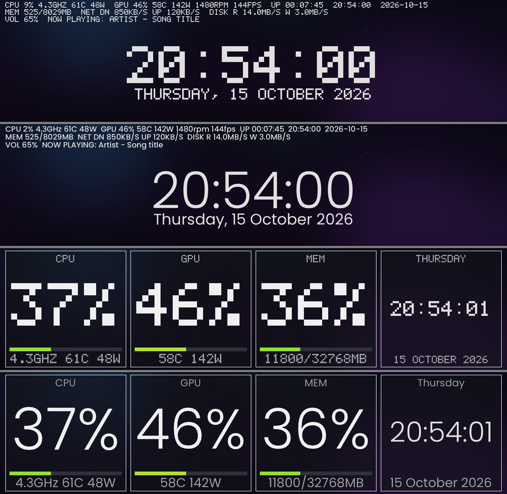

All the text of the program — status lines, big clock and date, every layout, the music screen,
the ticker, the weather panel — can be drawn in two fonts: `font = pixel` (the default, the
blocky 5x7 font) or `font = smooth`, anti-aliased **Poppins** with mixed case, accents and the
degree sign. Capital letters keep the height of the pixel font, so every screen keeps its
proportions, and the edges stay smooth over a picture, an effect or a semi-transparent panel.
`font_weight = auto | light | regular | medium` chooses the weight (auto: stronger for small
text, lighter for the clock). The `tiles` layout keeps its own `tiles_font`. The characters of
the matrix background and the pixel game are always pixel art. See the
**[Options guide](./OPTIONS_GUIDE.md#font)**.

```ini
font = smooth
```

### Pixel game under the clock

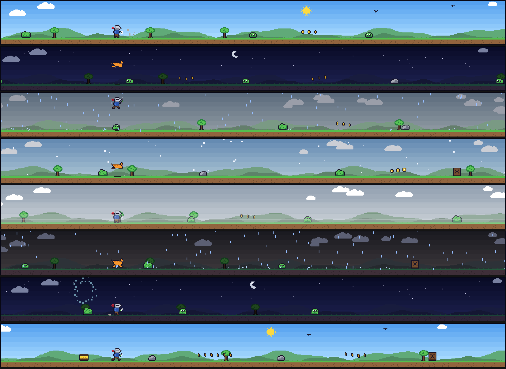

On the default screen (and on `default2`, the per-item one) a strip of
**pixel-art game** is drawn under the clock, which shrinks to make room. A
little knight or cat (`pixel_game_hero = knight | cat | both`) runs through a
scrolling landscape and jumps over rocks, bushes, crates, slimes and holes by
itself, and the world reacts to your computer:

- **CPU load** sets the running speed (a sprint with dust at high load);
- **music** makes the hero hop on the bass, with notes floating up;
- **network bursts** drop rows of coins and **disk bursts** a treasure chest;
- **on the hour** there are fireworks and a victory dance;
- the **sky follows the real time** (dawn, day, dusk, night with moon and stars)
  and the **weather** from the weather module (clouds, rain, snow, fog, thunderstorms).

It is on by default; `pixel_game = false` turns it off, `pixel_game_height = 20-70`
sets how much room it takes and `pixel_game_hud = false` hides the coin counter.
It never shows on the preset layout panels, the music screen or the in-game
dashboard. Because an animation needs smooth frames, the idle screen runs at
`--active-fps` while it is visible — see [Performance](#performance). Details in the
**[Options guide](./OPTIONS_GUIDE.md#pixel-game-mini-platformer-under-the-clock)**.

### Backgrounds: solid color and animated effects


Instead of a picture, the background can be a **solid color** or a **slow, animated effect**
that needs no file at all. It is drawn behind everything (clock, status lines, spectrum, the
pixel game, layouts, tiles) and costs almost no CPU.

**Solid color.** `background_color = black` (or any name, or a hex code such as `#0B1D3A`)
fills the whole panel with one flat color. An image, GIF, video or effect, if you also set one,
is shown instead.

**Soft effects.** `background_effect = plasma | aurora | lava | waves`: colors that blend into
each other and drift — a classic plasma, curtains of aurora, a lava lamp, silk-like ripples.
Pick the colors with `effect_palette` (`pastel`, `fluo`, `neon`, `candy`, `sunset`,
`ocean`, `aurora`, `fire`, `forest`, `ice`, `mono`, `rainbow` — several, or `all`,
rotate with a cross-fade every `effect_palette_interval` seconds) or give your own with
`effect_colors = #FF0080, #00FFFF`. `effect_speed` (0-100), `effect_scale` (25-400) and
`effect_brightness` (0-100, lower keeps the text readable) shape the look. The same effect can
also sit behind the music screen with `music_bg = effect`.

**Matrix and rain.** `background_effect = matrix` is a minimal **digital rain**: columns of
characters falling at different speeds, each with a bright head and a fading tail. `rain` is the
same idea reduced to the bare minimum, thin streaks of light without characters. Both are
sparse, so text stays readable. They have their own one-color palettes — `matrix` (green, the
default), `amber` (old terminal), `violet`, `crimson` and `snow` (white) — and any other palette
or your own `effect_colors` work too.

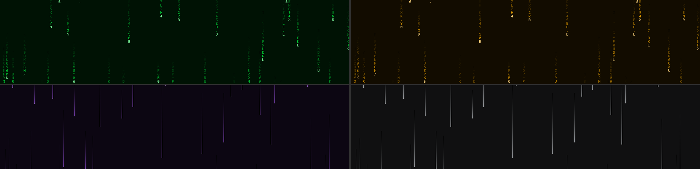

**Aquarium.** `background_effect = aquarium` turns the panel into the glass of an aquarium seen
from the side: a moving, slightly irregular **water surface** with a bright edge (you always see
where the water ends), water that darkens with depth, slanting **rays of light**, shimmering
**caustics** and **bubbles** that rise and fade at the surface. `effect_level = 0-100` sets how
high the water reaches (`50` = half the panel). Water palettes: `lagoon` (turquoise, the
default), `deep` (blue to navy) and `tropical` (green-turquoise) — any other palette works too,
its lightest color becoming the surface. It also works in portrait.

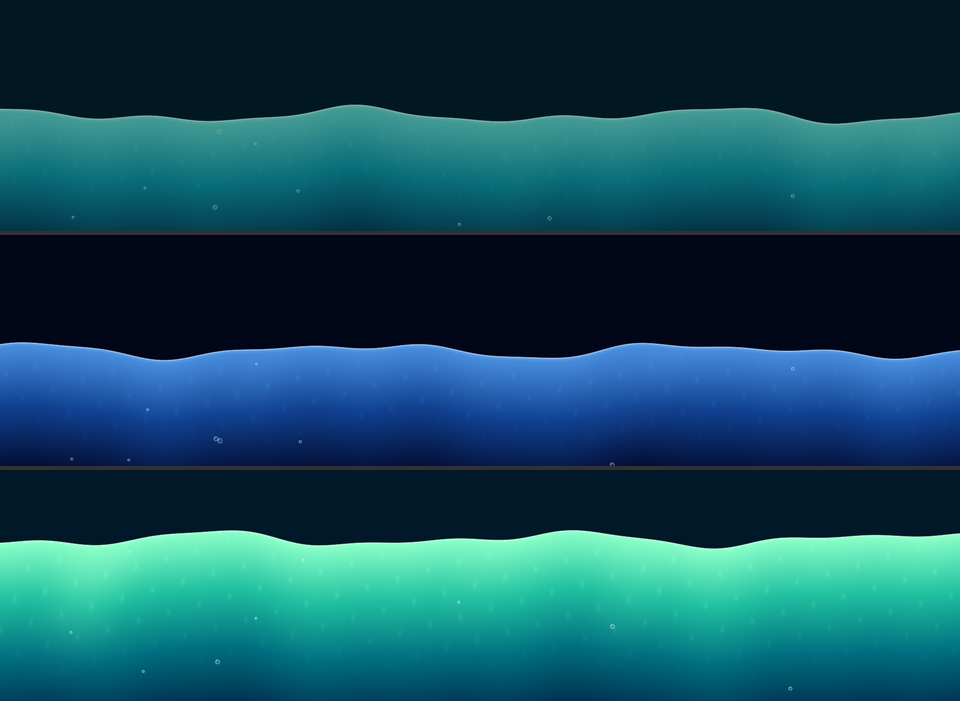

**Network and globe.** `background_effect = network` is a web of points drifting slowly,
joined by thin lines while they are near each other, so the net keeps changing shape (a few nodes
carry a ring). `globe` is the same on a sphere that turns and tilts slowly, the near side clearer
than the far one. Only lines and dots, no text. `effect_level` sets how many nodes there are,
`effect_scale` their spacing and size (and the size of the globe). They use the same palettes as
the other effects — the default is `ice`; a one-colour palette such as `crimson` gives grey lines
with red nodes, a several-colour one (`neon`, `rainbow`) nodes of different colors.

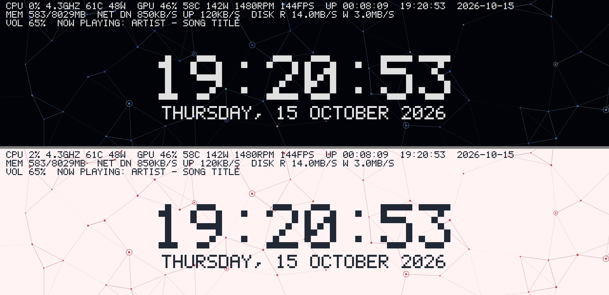

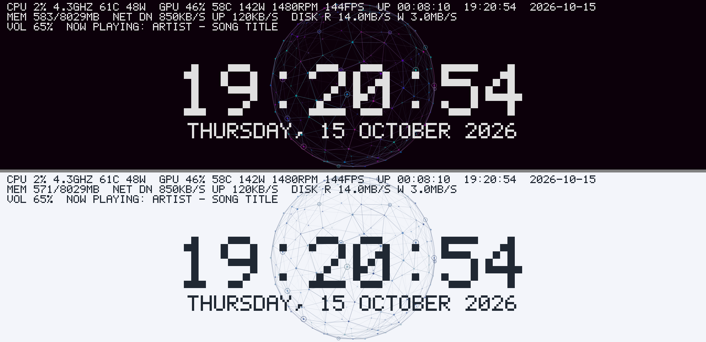

**Light (white) variants.** `effect_theme = light` gives `matrix`, `rain`, `aquarium`, `network`
and `globe` a **white background**: dark characters and streaks on white paper, a white room with
pale water that deepens in color toward the bottom, or grey-blue lines and nodes on white. `effect_brightness` then sets how saturated the colors
are. Remember to give the text a dark color:

```ini
background_effect = aquarium
effect_theme = light
effect_palette = lagoon
clock_color = #14323C
text_color = #14323C
```

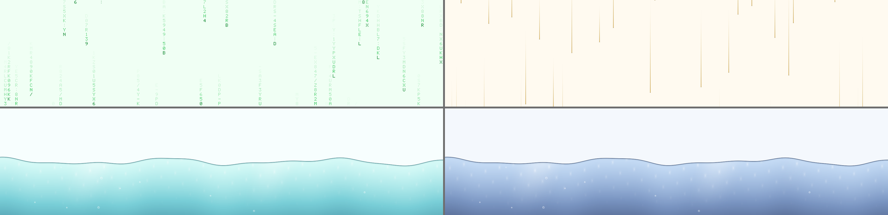

```ini
background_effect = matrix            # a minimal digital rain...
effect_palette = amber                # ...like an old terminal

# background_effect = aquarium        # or an aquarium, water up to 60% of the height
# effect_palette = deep
# effect_level = 60

# background_effect = network         # or nodes and thin lines (globe: a turning sphere)
# effect_theme = light
# effect_palette = crimson
```

It is built to be light: the picture is only calculated on a coarse grid and
stretched through a color table (about a millisecond per frame; the aquarium, a few
milliseconds), and `effect_fps` (default 8) keeps the number of frames low — see
[Performance](#performance). Details and every key in the
**[Options guide](./OPTIONS_GUIDE.md#animated-background-effect-plasma-aurora-lava-waves-matrix-rain-aquarium-network-globe)**.

### Brightness, DeepCool, FPS

- `brightness = 0-100`: software dimming (no LY brightness command is known).
- `deepcool = false` (or `--no-deepcool`): never touch the DeepCool display.
- Game dashboard FPS works on any GPU via ETW (DirectX 9–12 games; run as
  Administrator; Vulkan/OpenGL-native games are not covered). NVIDIA GPU
  temperature/power/clock come from NVML (`nvml.dll`, shipped with the
  driver), falling back to `nvidia-smi`. `--diag` prints what each source
  returns.

### Weather

Current temperature and a small stylized condition icon (sun, cloud, rain,
snow, fog, thunder...), from [Open-Meteo](https://open-meteo.com/) (free, no
API key). By default the location is guessed from the machine's public IP
address; set `weather_city = Milano` (or `--weather-city`) to use a fixed city
instead — changing it needs a restart, since it re-spawns the background
fetch thread. `weather_unit = c` (default) or `f` picks the temperature unit,
and applies live. The weather can be shown two ways: as a per-item line named
`weather` (see "Per-item control" below, `default2`), and/or as its own big
panel (`layout = weather`, or e.g. `layout = default, weather` to rotate with
the standard screen). If the network is unreachable or the location
can't be resolved yet, the item just shows "N/A" until the first fetch
succeeds; nothing else in the program is affected. `--diag` also prints the
resolved location and a sample reading.

The `weather` panel also shows a **7-day forecast strip** below the current
conditions: one column per day, with the abbreviated day name, a small
condition icon, the high/low temperature and (when the model provides it) the
rain probability. It's automatic — no extra config — and comes from the same
Open-Meteo request as the current conditions. In portrait mode the columns
shrink to fit the narrower panel, same idea as everything else that adapts to
orientation.

### Ticker (news headlines, or any custom feed)

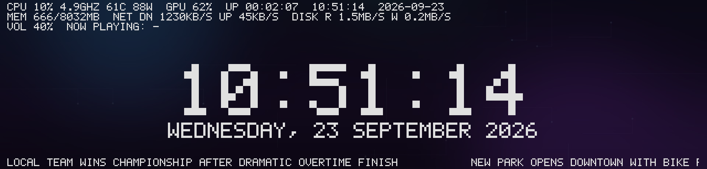

Scrolling headlines from one or more sources, refreshed on a background
thread (same idea as the weather module). Set one or more comma-separated
`ticker_source` entries — each can be an **RSS/Atom feed URL** (headlines
come from each item's title), **any other URL** (not a feed, so each
non-empty line of the response becomes one item — point it at your own
script or webhook), or a **local file path** (one item per non-empty line,
re-read on every refresh). Two independent ways to show it, usable together:
a scrolling line drawn on top of whatever else is on screen (`show`/`hide =
ticker`, styled with `ticker_position`/`ticker_size`/`ticker_color`/
`ticker_backdrop`/`ticker_width`), and/or its own full panel (`layout =
news`). `ticker_source`/`ticker_refresh_min` (default 10 minutes) need a
restart, like `weather_city`; everything else applies live.

```ini
ticker_source = https://www.ansa.it/sito/ansait_rss.xml
ticker_refresh_min = 10
show = ticker
layout = default, news:20
```

See the **[Options guide](./OPTIONS_GUIDE.md#ticker)** for the full reference
and more examples (combining feeds and files, styling the chyron, etc.).

### Preset layouts

`layout = default | cpu-gpu | temps | overview | grid6 | clock-center | io | music | gaming | cpu | gpu | weather | news | tiles`
(`--layout list` prints them). All of them, shown here over a sample background
(`background = img/sample_background.jpg`, `panel_opacity = 60`):

| | | |
|---|---|---|
| 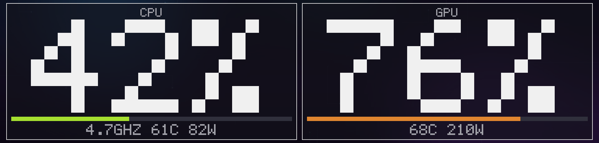<br>`cpu-gpu` | 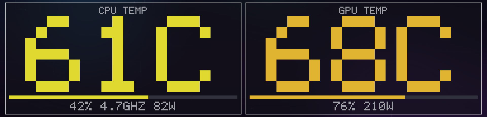<br>`temps` | 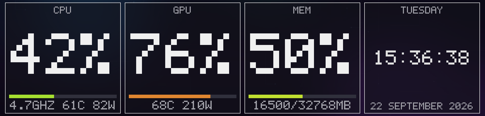<br>`overview` |
| 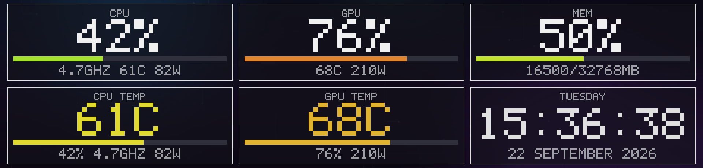<br>`grid6` | 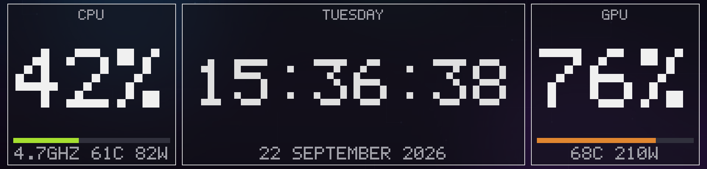<br>`clock-center` | 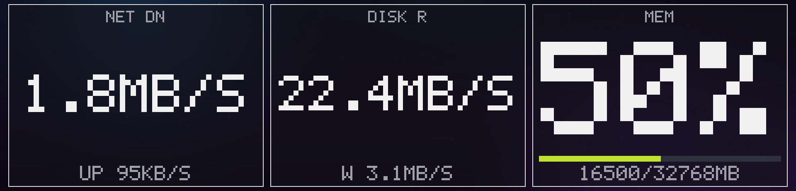<br>`io` |
| 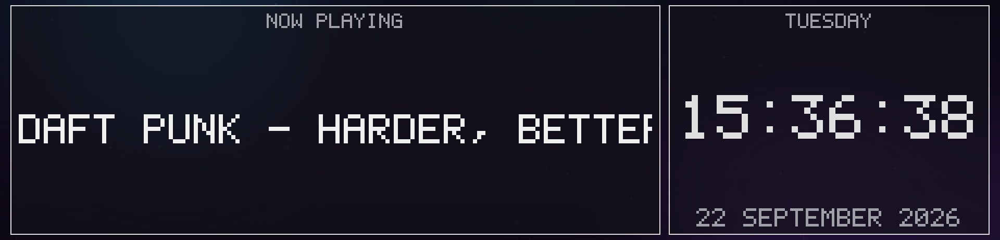<br>`music` | 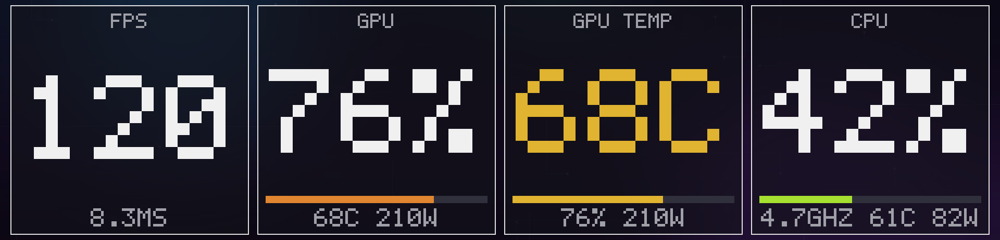<br>`gaming` | 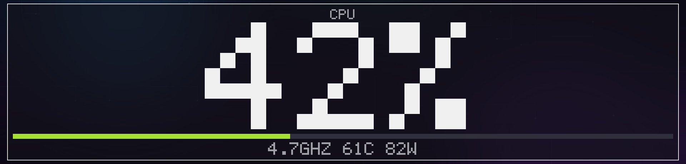<br>`cpu` |
| 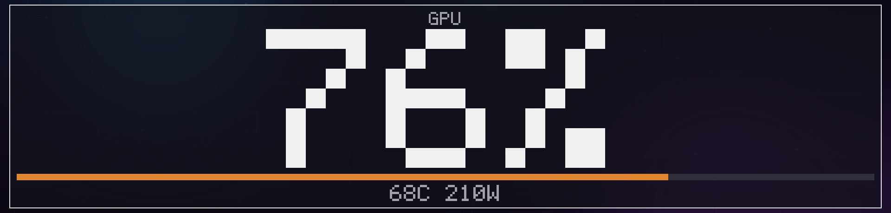<br>`gpu` | 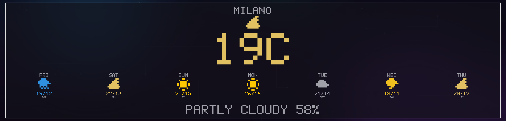<br>`weather` | 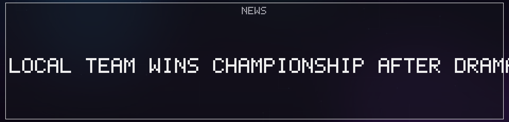<br>`news` |

Several layouts separated by commas rotate every
`layout_interval` seconds (`layout = cpu-gpu, temps, music`). Each entry can also carry its own
duration with `name:seconds`, instead of splitting the time equally — `layout = default:30, weather:5`
keeps the standard screen up for 30s straight, then the weather panel for 5s, then back to 30s of
the standard screen (not alternating every 5s); an entry with no `:seconds` falls back to
`layout_interval`. `default2` is the same screen but with the per-item styling below (`default`
stays classic; per-item options without any `layout` imply `default2`). `default` is the standard
screen (status lines, spectrum, big clock) and can be part of the rotation (`layout = default, cpu-gpu`).
`trofeo_lcd.exe --diag` prints NVIDIA/AMD GPU sensor diagnostics. `text_backdrop = true` puts a panel
behind the status lines and big clock (same opacity); `panel_opacity = 0-100`
makes panels see-through over the background. Big panels replace the clock; portrait stacks
them vertically. See `trofeo.conf.example`. In the [settings editor](#settings-editor-trofeo_config),
the *Screens (layouts)* section builds the rotation with a list (add, reorder, seconds per screen)
and the preview lets you look at each screen in turn.

### Tiles layout (glass dashboard)


`layout = tiles` shows rounded, semi-transparent tiles with big values, a progress
bar or a ring and an optional second value — the clock, CPU/GPU load, temperatures
and watts, RAM, network, disk, FPS, weather and the playing track. You choose
**which tiles** to show and in which rows, the **font** (anti-aliased "smooth" or the
classic pixel font), the **colors** of the bars and rings (all of them, or one
tile at a time) and what is **behind** the tiles:

```ini
layout = tiles
# Rows are separated by "|"; ":ring" draws a ring instead of a bar,
# "clock:tall" makes the clock as tall as all the rows.
tiles = clock:tall, cpu_temp, gpu_temp | ram:ring, cpu:ring, gpu:ring
tiles_font = smooth                         # smooth | pixel
tiles_theme = dark                          # dark | light
tiles_bar_color = #00C8FF, #FF0080          # all bars and rings: one color or a gradient (default: auto)
tile_gpu_color = #FFC800                    # ...and one tile on its own
tiles_bg = gradient                         # global | color | gradient | effect | image
tiles_bg_color = #1B2A4A, #4A1B3A
```


Tiles: `clock cpu cpu_temp cpu_watt gpu gpu_temp gpu_watt ram net disk fps weather music`.
Backgrounds: whatever the other screens use (`global`), a color, a gradient, the
animated effects of [Backgrounds](#backgrounds-solid-color-and-animated-effects)
(matrix, rain, the aquarium, the network and the globe included),
or an image just for this screen. Works on 1920×462, 1920×400 and in portrait; the
tiles are redrawn only when something changes, so even an animated background costs
little. All the keys are in the [options guide](./OPTIONS_GUIDE.md#tiles-layout). In the
[settings editor](#settings-editor-trofeo_config) the *Tiles* section lets you build the rows
by picking each tile from a list and toggling *ring* / *tall*.

### Live reload

`trofeo.conf` is re-read every second; saved changes apply without restarting (a broken file is ignored and the previous settings stay). Only `deepcool`, `fps_monitor`, OpenRGB, `hide_console`, `screenshot_key`, `weather_city`, `ticker_source` and `ticker_refresh_min` need a restart. If a saved file is invalid, the previous settings stay active and the reason is written to `trofeo-errors.txt` next to the executable. The [settings editor](#settings-editor-trofeo_config) relies on this: save in the editor and the LCD updates by itself.

### Per-item control

Every info item (`cpu, gpu, uptime, time, date, mem/ram, net, disk, volume, nowplaying, weather`) can be
turned on/off with `show`/`hide` and styled on its own with `<item>_size` (1-30), `<item>_position`
(3x3 grid), `<item>_color` and `<item>_backdrop`. Setting any of them switches the info block to
per-item mode (items on the same position stack, and the track scrolls without overlapping its
neighbors). Details inside the CPU/GPU lines can be hidden with
`hide = cpu_freq, cpu_temp, cpu_power, gpu_temp, gpu_power, gpu_fan, gpu_clock, gpu_fps`.
`clock_time_size` / `clock_date_size` set the big clock's sizes, and `net_unit` (`kb|mb|auto`) /
`mem_unit` (`mb|gb`) set the network and RAM units. `percent_decimals = 1` adds a decimal place to
every CPU/GPU/RAM usage percentage shown anywhere (`37%` → `37.4%`); default `0` keeps the original
whole-number look.

### Autostart on Windows

`scripts/install-autostart.ps1` (included in the Windows release zip) adds
`trofeo_lcd.exe` to Windows startup. By default it registers a **Scheduled
Task** that runs at logon with elevated ("Run as administrator")
privileges and no UAC prompt on every login — needed if you use
`fps_monitor` or PawnIO (AMD sensors). Run it from the folder with the exe:

```powershell
.\scripts\install-autostart.ps1                              # elevated task, --hide-console
.\scripts\install-autostart.ps1 -Arguments ""                # elevated task, console visible
.\scripts\install-autostart.ps1 -Method Shortcut              # simple Startup-folder shortcut, no admin needed, not elevated
```

Remove it with `.\scripts\uninstall-autostart.ps1` (removes whichever
method was used). See the comments at the top of each script (or
`Get-Help .\scripts\install-autostart.ps1 -Full`) for every option.
Only `trofeo_lcd.exe` is started at logon: the settings editor is opened by hand when you want it.

## Second monitor mode

Run **`trofeo_screen`** (instead of `trofeo_lcd` — they share the LCD, so
don't run them together):

```bash
./target/release/trofeo_screen --list-displays    # list monitors
./target/release/trofeo_screen                    # stream to LCD
```

Requires a *Virtual Display Driver* (VDD) at 1920×462 — see
**[GUIDE_SECOND_MONITOR.md](./GUIDE_SECOND_MONITOR.md)**.

## Structure

- `src/lib.rs` — USB driver: handshake, chunking, JPEG encode, `Framebuffer`.
- `src/audio.rs` — audio capture (WASAPI / PulseAudio-PipeWire).
- `src/cpu_sensor.rs`, `src/cpu_freq.rs` — CPU temp/power & frequency.
- `src/deepcool/` — DeepCool display drivers (HID).
- `src/dxgi_capture.rs` + `src/bin/screen.rs` — second monitor mode.
- `src/weather.rs` + `src/weather_icon.rs` — weather (Open-Meteo) and its condition icons.
- `src/ticker.rs` — news ticker: RSS/Atom feeds, plain-text URLs, or a local file.
- `src/spectrum.rs` — spectrum styles and color palettes.
- `src/media.rs` + `src/music_screen.rs` — now-playing info (Windows media controls / `playerctl`) and the Spotify-style music screen.
- `src/pixel_game.rs` — the self-playing pixel-art platformer under the clock.
- `src/effect.rs` — the animated backgrounds (plasma, aurora, lava, waves, matrix, rain, aquarium, network, globe and their light variants).
- `src/tiles.rs` — the tiles layout; `src/smooth_font.rs` + `assets/` — the anti-aliased text, used by the tiles and (`font = smooth`) by every other text (embedded Poppins font, SIL OFL: see `assets/OFL.txt`).
- `src/bin/config_editor.rs` — the settings editor window (`trofeo_config`, built with egui).
- `src/schema.rs` — the list of every setting the editor shows (names, ranges, defaults, texts in English and Italian); tests check it against the real parser, so the editor can only write what the program accepts.
- `src/conf_edit.rs` — line-by-line editing of `trofeo.conf` that keeps comments and untouched lines.
- `src/main.rs` — main loop: audio → FFT → EQ bars → send to screen (and `--preview-png`, which draws one frame for the editor's preview).

## Performance

Measured on a Windows PC (12 logical processors), running `trofeo_lcd` at
default settings (idle FPS 2 / active 15, DeepCool enabled), before the pixel
game existed:

| Metric | Measured |
|---|---|
| RAM | ~13 MB working set (stable, no growth) |

It stays this light thanks to adaptive FPS (JPEG encode + USB transfer only
happen while there is audio) and the CPU optimizations in `src/main.rs` /
`src/lib.rs`.

The **pixel game** (on by default) trades some of that for animation: while it
is on screen the idle screen runs at the active FPS (15) instead of the idle
one (2). Drawing the game itself costs well under a millisecond per frame; the
extra load is JPEG-encoding and sending more frames. Set `pixel_game = false`
to get the minimal-load behavior measured above. These figures have not been
re-measured with the game on.

An **animated background effect** works the same way: building the picture takes about a
millisecond (matrix and rain a little less; the aquarium about 5 ms, the network 1-2 ms and the globe about 3 ms), and the cost that matters is
the extra frames. It uses its own, low `effect_fps` (default 8) while it moves instead of the
idle 2 fps, so it sits between the idle screen and the game; lower `effect_fps` or set
`effect_speed = 0` (a still picture, idle FPS unchanged) to make it lighter still. A **solid
color** background costs nothing extra.

The **settings editor** is not part of this: it is a separate program, and it only needs to be
open while you change settings. Its preview starts `trofeo_lcd` for a moment to draw each frame
and exits; it never touches the LCD, the audio or the sensors, so it can be used while the
display is running.

## Credits

- Original project: [sukualam/trofeo-lcd](https://github.com/sukualam/trofeo-lcd)
  — this repository is a fork of it.
- USB protocol reverse-engineering:
  [thermalright-trcc-linux](https://github.com/Lexonight1/thermalright-trcc-linux)
  by Lexonight1.
- The smooth font (tiles layout and `font = smooth`) uses a subset of the [Poppins](https://github.com/itfoundry/Poppins) font
  (© The Poppins Project Authors, SIL Open Font License 1.1 — `assets/OFL.txt`).
- The settings editor is built with [egui / eframe](https://github.com/emilk/egui)
  (MIT or Apache-2.0) and, on Windows, [rfd](https://github.com/PolyMeilex/rfd) (MIT) for the file dialogs.
- See **[NOTICE.md](./NOTICE.md)** for what has changed in this fork.

## License

[GPL-3.0-or-later](./LICENSE) (follows the referenced upstream project).
