# Configuration cookbook

[← Back to the README](../README.md) · [All the docs](./README.md)

## Orientation (landscape / portrait)

The 9.16" panel is physically 1920×462 (1920×400 for the 11.3"). If you mount it upright, use portrait:
the UI is drawn on a 462×1920 canvas (400×1920 on the 11.3") and rotated for the panel. Set it in a
config file (copy `trofeo.conf.example` to `trofeo.conf` next to the
executable, or pass `--config <FILE>`) or on the command line:

```bash
./trofeo_lcd --orientation portrait          # display mounted upright
./trofeo_lcd --orientation portrait --flip   # upright, but upside-down
```

`--flip` adds 180° in either orientation. Command-line options override the
config file. In `trofeo_screen` portrait mode the virtual display must be
**462×1920** (auto-detected by `--list-displays`).

**Every layout works in portrait.** The classic layouts and `tiles` stack their panels in a column, and
`deck`, `cards`, `orbit` and `console` (from 2.9.0) turn their columns and clusters into rows: `deck` gives each
device a row, `cards` puts the cards one under the other (the groups of `cards = a | b, c` are read in order),
`orbit` stacks the rings with the clock block last, and `console` stacks its tiles with the one in focus taller.
The screenshots below are the preview of each layout on a 462×1920 panel (`orientation = portrait`).

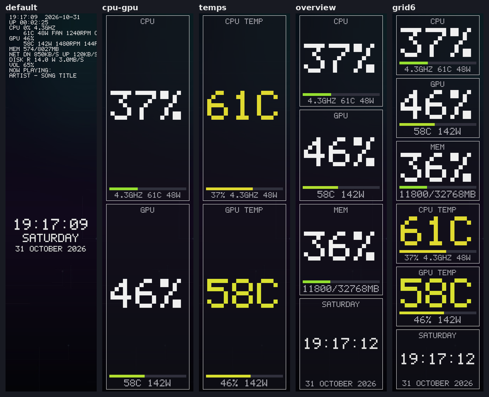

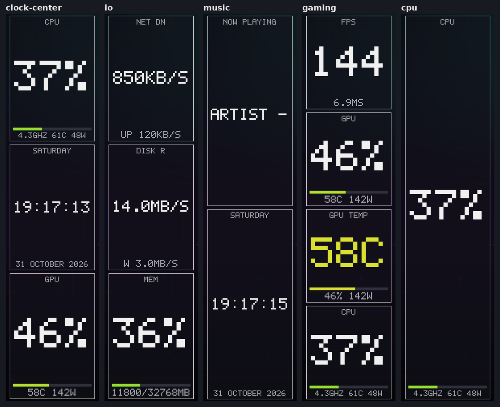

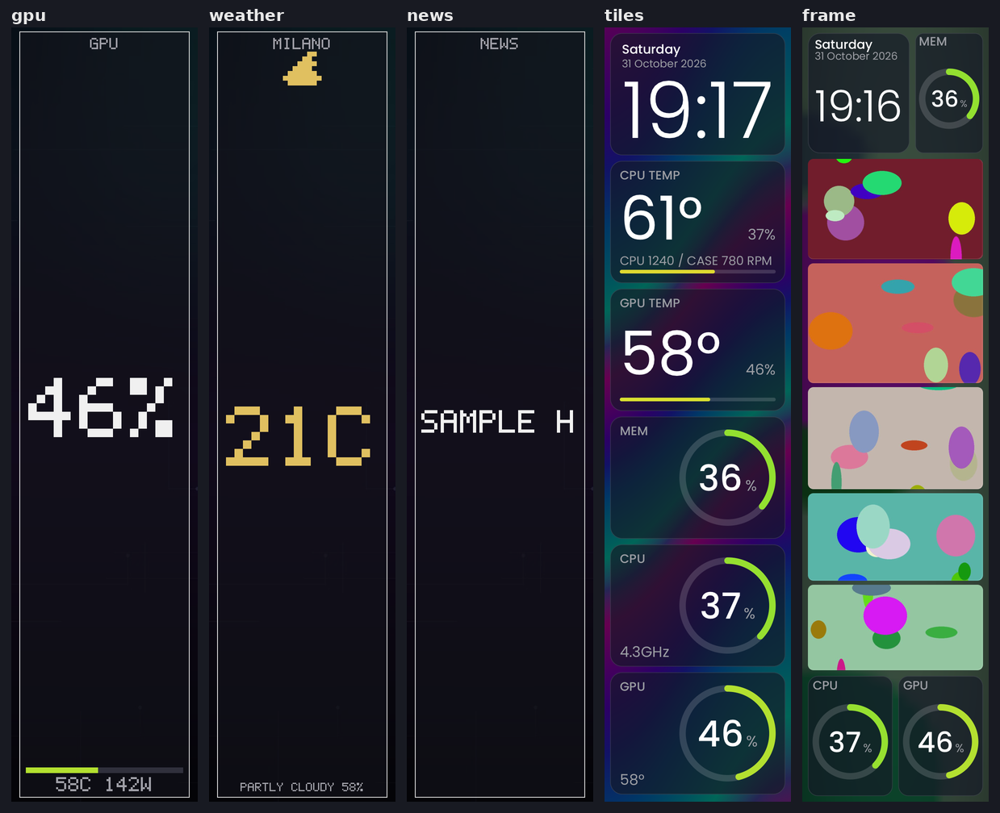

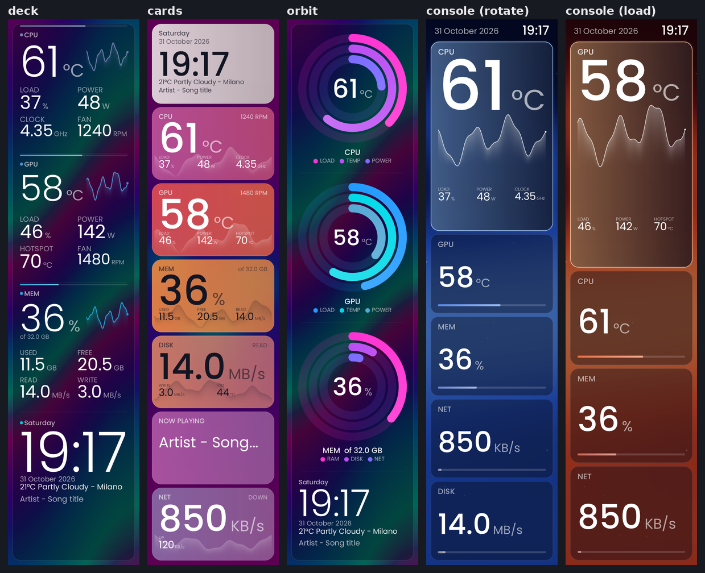

## Margins, language, background

Also settable in `trofeo.conf` (see `trofeo.conf.example`), in the [settings editor](../README.md#settings-editor-trofeo_config), or via CLI:

- `--margin <PX>` (or `--margin-top/-bottom/-left/-right`): keep the UI away
  from the screen edges. Works in `trofeo_screen` too.
- `--language <en|it|de|es|fr|pt>` (default `en`): UI text and date names in
  English, Italian, German, Spanish, French, or Portuguese. Accented letters
  are written in ASCII-safe form since the bitmap font has no accent glyphs
  (e.g. German spells out umlauts as `AE`/`OE`/`UE` and `ß` as `SS`; Italian,
  Spanish, French and Portuguese drop the accent, with Italian keeping its
  usual apostrophe-for-accent spelling on day names like `Lunedi'`).
- `--background <FILE>`: JPEG/PNG/BMP image, animated GIF, or video. Video
  needs **ffmpeg** (`ffmpeg.exe` next to the program, in `PATH`, or `--ffmpeg <PATH>`).
  `--background-dim <0-100>` darkens it (default 40). With an animated
  background the idle FPS is raised to the active FPS so it stays smooth.
  A sample background (`img/sample_background.jpg`) is included in this repo
  if you just want to try it: `background = img/sample_background.jpg` — it's
  also what the [preset layout screenshots](#preset-layouts) below are shown over.
- `background_color = black | #0B1D3A | …`: a **solid color** instead of a picture — a name
  (`black`, `white`, `pink`, `navy`, `teal`, …) or a hex code. See
  [Backgrounds](#backgrounds-solid-color-and-animated-effects).
- `background_effect = plasma | aurora | lava | waves | matrix | rain | aquarium | sea | ink | veil | network | globe`: an
  **animated background** with no file needed — see
  [Backgrounds](#backgrounds-solid-color-and-animated-effects).
  It replaces `background` while it is on.

### What to show, where, and colors

- **Music screen**: `music_screen = true` turns the panel into a Spotify-style
  now-playing card while a track plays (nine designs, `music_layout`) — album cover with glow, artist/title,
  progress bar, spectrum on the side, all tinted with the cover's colors. The
  background is configurable (`music_bg = gradient | blur | color | solid | none | effect`,
  with brightness / blur / fit options), and a small footer with CPU / GPU / RAM
  load (`music_stats`, selectable). The spectrum color on this screen is its own
  setting (`music_spectrum_color`: cover color, a fixed color, a gradient or presets). Needs the player's cover to be exposed by the
  system (Windows media controls / `playerctl` on Linux).
- **Spectrum looks**: `spectrum_style = bars | led | peaks | area | mirror | all`
  and `spectrum_palette = rainbow | fire | ocean | sunset | neon | ice | matrix |
  purple | all` (or your own `spectrum_gradient = #FF0080, #00FFFF`); lists
  rotate on a timer. `layout_hold_on_music = true` keeps the first layout on
  screen while music plays instead of rotating.
- `show = cpu, gpu, …` / `hide = spectrum, clock_date, …` choose what is drawn
  (`cpu gpu uptime time date mem net disk volume nowplaying weather ticker
  spectrum clock clock_date dashboard`). Hiding `spectrum` keeps the big clock
  on screen during playback.
- `status_position`, `clock_position`, `spectrum_position` (+ `spectrum_width/height`),
  `ticker_position` (+ `ticker_width`) take one of 9 anchors: `top-left`, `top`,
  `top-right`, `center-left`, `center`, `center-right`, `bottom-left`, `bottom`,
  `bottom-right`.
- `text_color`, `clock_color`, `color` (bars): `#RRGGBB`, `R,G,B` or a name. Every color option
  understands the same long list of names (`black white gray silver red darkred green darkgreen
  lime olive blue navy lightblue skyblue yellow gold cyan teal turquoise magenta pink hotpink
  salmon coral orange brown beige purple violet indigo lavender`, also in Italian), not case
  sensitive: `dark green` = `darkgreen`.
- `background_fit` (`cover|stretch|contain|original`), `background_position`,
  `background_offset_x/y`.

Every key is also a CLI flag (`--hide spectrum`, `--clock-position top-right`).

### Font

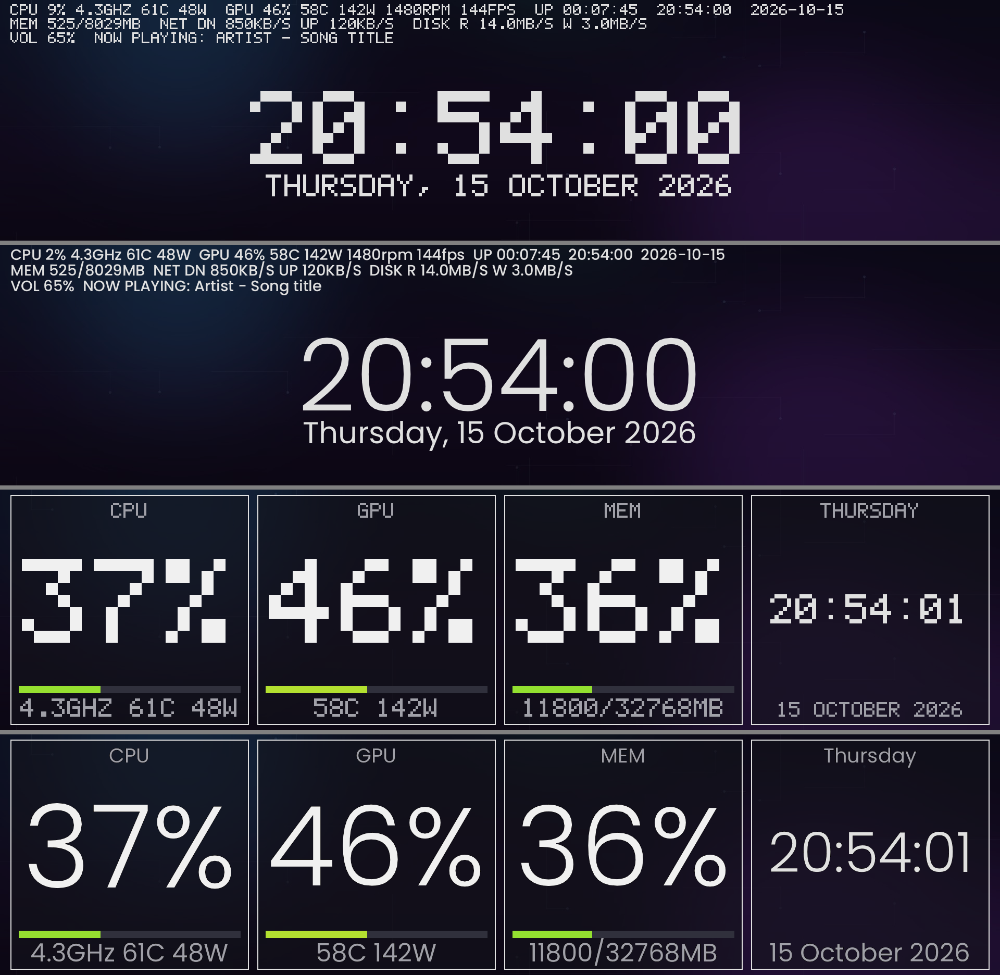

All the text of the program — status lines, big clock and date, every layout, the music screen,
the ticker, the weather panel — can be drawn in two fonts: `font = pixel` (the default, the
blocky 5x7 font) or `font = smooth`, anti-aliased **Poppins** with mixed case, accents and the
degree sign. Capital letters keep the height of the pixel font, so every screen keeps its
proportions, and the edges stay smooth over a picture, an effect or a semi-transparent panel.
`font_weight = auto | light | regular | medium` chooses the weight (auto: stronger for small
text, lighter for the clock). The `tiles` layout keeps its own `tiles_font`. The characters of
the matrix background and the pixel game are always pixel art. See the
**[Options guide](../OPTIONS_GUIDE.md#font)**.

```ini
font = smooth
```

### Pixel game under the clock

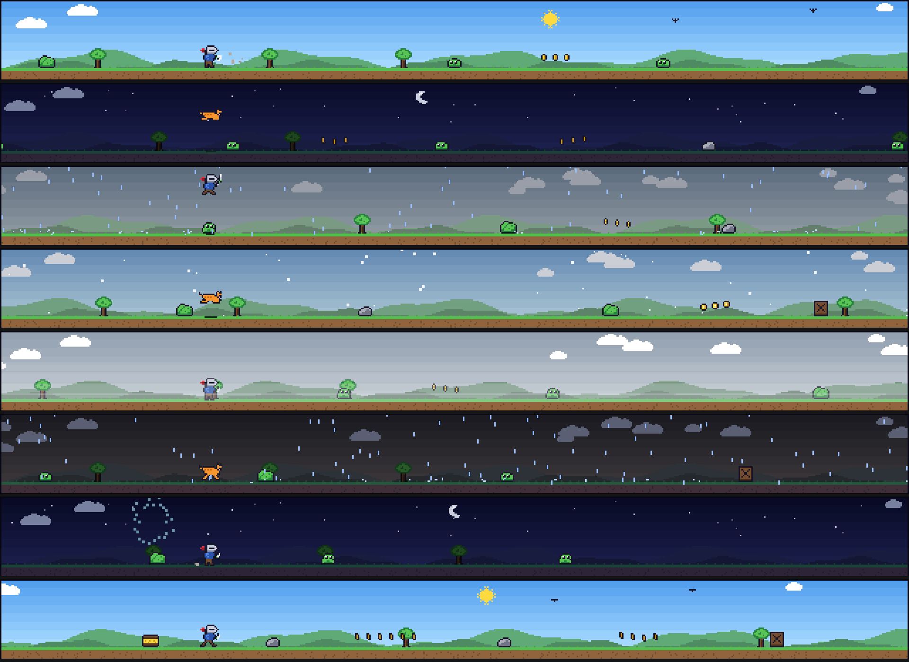

On the default screen (and on `default2`, the per-item one) a strip of
**pixel-art game** is drawn under the clock, which shrinks to make room. A
little knight or cat (`pixel_game_hero = knight | cat | both`) runs through a
scrolling landscape and jumps over rocks, bushes, crates, slimes and holes by
itself, and the world reacts to your computer:

- **CPU load** sets the running speed (a sprint with dust at high load);
- **music** makes the hero hop on the bass, with notes floating up;
- **network bursts** drop rows of coins and **disk bursts** a treasure chest;
- **on the hour** there are fireworks and a victory dance;
- the **sky follows the real time** (dawn, day, dusk, night with moon and stars)
  and the **weather** from the weather module (clouds, rain, snow, fog, thunderstorms).

It is on by default; `pixel_game = false` turns it off, `pixel_game_height = 20-70`
sets how much room it takes and `pixel_game_hud = false` hides the coin counter.
It never shows on the preset layout panels, the music screen or the in-game
dashboard. Because an animation needs smooth frames, the idle screen runs at
`--active-fps` while it is visible — see [Performance](PERFORMANCE.md#performance). Details in the
**[Options guide](../OPTIONS_GUIDE.md#pixel-game-mini-platformer-under-the-clock)**.

### Backgrounds: solid color and animated effects


Instead of a picture, the background can be a **solid color** or a **slow, animated effect**
that needs no file at all. It is drawn behind everything (clock, status lines, spectrum, the
pixel game, layouts, tiles) and costs almost no CPU.

**Solid color.** `background_color = black` (or any name, or a hex code such as `#0B1D3A`)
fills the whole panel with one flat color. An image, GIF, video or effect, if you also set one,
is shown instead.

**Soft effects.** `background_effect = plasma | aurora | lava | waves`: colors that blend into
each other and drift — a classic plasma, curtains of aurora, a lava lamp, silk-like ripples.
Pick the colors with `effect_palette` (`pastel`, `fluo`, `neon`, `candy`, `sunset`,
`ocean`, `aurora`, `fire`, `forest`, `ice`, `mono`, `rainbow` — several, or `all`,
rotate with a cross-fade every `effect_palette_interval` seconds) or give your own with
`effect_colors = #FF0080, #00FFFF`. `effect_speed` (0-100), `effect_scale` (25-400) and
`effect_brightness` (0-100, lower keeps the text readable) shape the look. The same effect can
also sit behind the music screen with `music_bg = effect`.

**Matrix and rain.** `background_effect = matrix` is a minimal **digital rain**: columns of
characters falling at different speeds, each with a bright head and a fading tail. `rain` is the
same idea reduced to the bare minimum, thin streaks of light without characters. Both are
sparse, so text stays readable. They have their own one-color palettes — `matrix` (green, the
default), `amber` (old terminal), `violet`, `crimson` and `snow` (white) — and any other palette
or your own `effect_colors` work too.

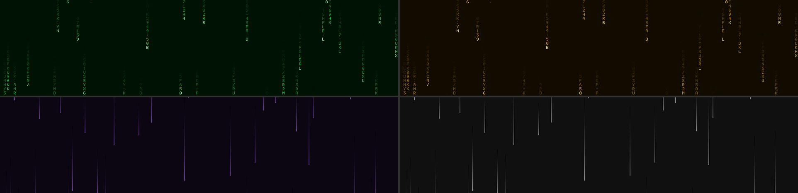

**Aquarium.** `background_effect = aquarium` turns the panel into the glass of an aquarium seen
from the side: a moving, slightly irregular **water surface** with a bright edge (you always see
where the water ends), water that darkens with depth, slanting **rays of light**, shimmering
**caustics** and **bubbles** that rise and fade at the surface. `effect_level = 0-100` sets how
high the water reaches (`50` = half the panel). Water palettes: `lagoon` (turquoise, the
default), `deep` (blue to navy) and `tropical` (green-turquoise) — any other palette works too,
its lightest color becoming the surface. It also works in portrait. `effect_flip = true` turns it
**upside down**: the water hangs from the top of the panel.

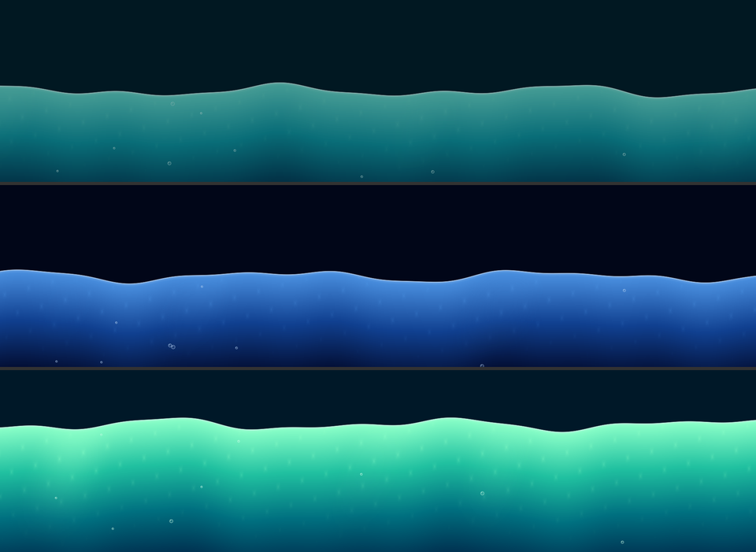

**The water as a gauge, and moving with the music.** Two options make the aquarium and the sea
alive. `effect_level_source = cpu` (or `gpu`, `ram`) makes the water level follow that load: a full
tank means a busy PC, a nearly empty one an idle PC (it never goes below 5%, and it rises and falls
smoothly over a second or so; `effect_level` is not used then). `effect_reactive = true` makes the
surface rise with the bass of the music, the light rays brighten and, in the sea, the sun glows and the near waves
grow; the ink spreads faster and thicker. In silence everything is calm. Both need nothing installed; a
reactive effect refreshes at least 15 times a second (a load-driven one at least 10), whatever `effect_fps` says.

```ini
background_effect = aquarium
effect_level_source = cpu        # none | cpu | gpu | ram
effect_reactive = true           # the music moves the water
```

**Sea.** `background_effect = sea` is a sunset seen from the water: a sky that goes from night blue
to orange at the horizon, the **sun** on the horizon with its glow, and five **layers of waves**, each
larger and darker than the one behind (the far ones take the orange of the sky, the near ones the color of
the water), with a light edge, **foam** on the nearest two and the sun's **glitter** on the water, a column
that widens towards you. `effect_level` sets how much of the panel is sea (`50` = the horizon in the middle),
the water takes the aquarium's palettes (`lagoon` by default, `deep`, `tropical`...). With
`effect_theme = light` the sky is a clear day. It also works in portrait.

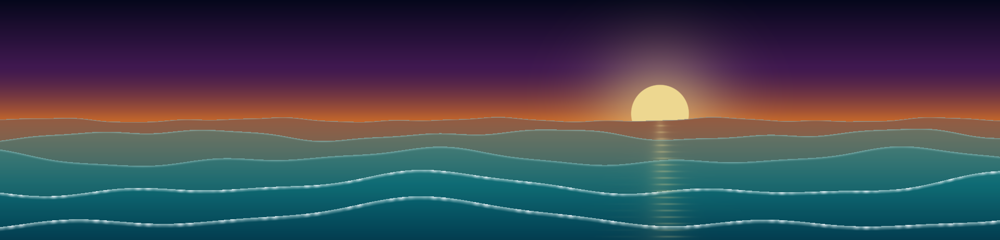

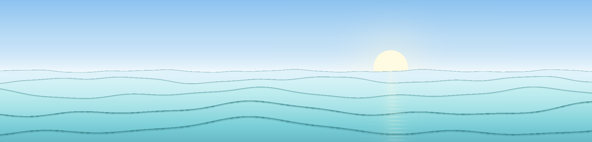

**Ink.** `background_effect = ink` is clouds of coloured ink spreading and curling in dark water (or
dark ink on white paper in the light variant). The colors come from the palette (`sunset` by default; `neon`,
`ocean`, `aurora`, `fire` and `rainbow` look good too) and drift along it as the clouds move; `effect_scale`
makes the swirls larger or smaller. Both the sea and the ink do a little more work than the other effects
(about 15 ms a frame on a large screen): lower `effect_fps` if you want them lighter.

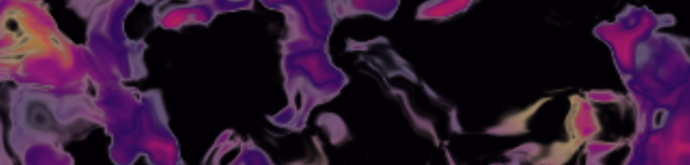

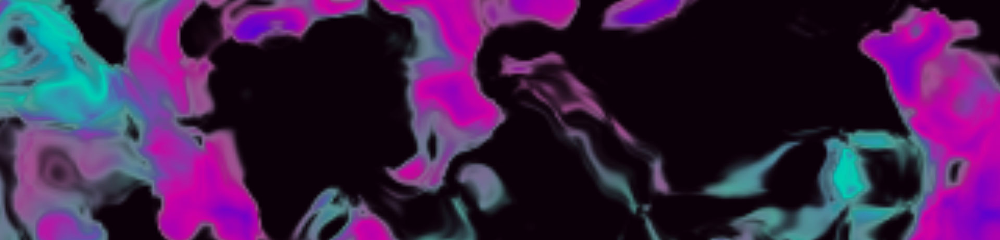

**Veil.** `background_effect = veil` is slow, silky bands of light that sway over a deep night gradient, with a few specks
floating up like dust in a beam of light — calm, dark and easy to read text on. The palettes made for it are
`midnight` (the default, blue), `dusk` (violet), `ember` (red-orange), `mint`, `rose` and `slate`; any other
palette works too. `effect_level` is how many specks float about (`0` = none), `effect_scale` the width of the bands,
`effect_reactive = true` lets the music widen the bands and brighten the specks. It costs only about 4 ms a frame.

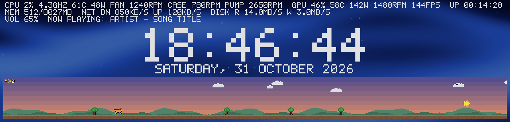

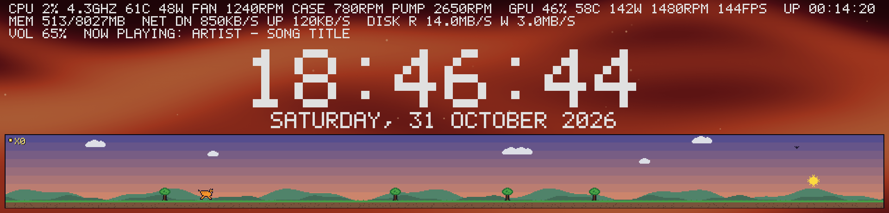

**Network and globe.** `background_effect = network` is a web of points drifting slowly,
joined by thin lines while they are near each other, so the net keeps changing shape (a few nodes
carry a ring). `globe` is the same on a sphere that turns and tilts slowly, the near side clearer
than the far one. Only lines and dots, no text. `effect_level` sets how many nodes there are,
`effect_scale` their spacing and size (and the size of the globe). They use the same palettes as
the other effects — the default is `ice`; a one-colour palette such as `crimson` gives grey lines
with red nodes, a several-colour one (`neon`, `rainbow`) nodes of different colors.

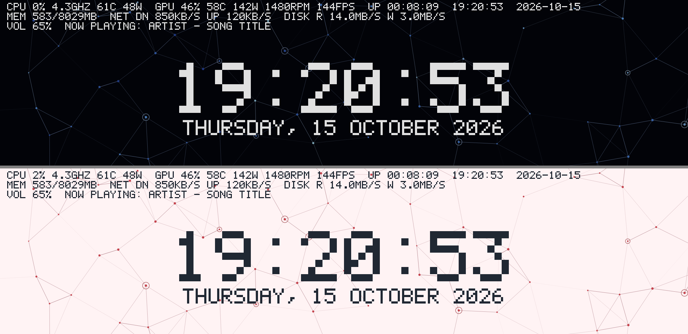

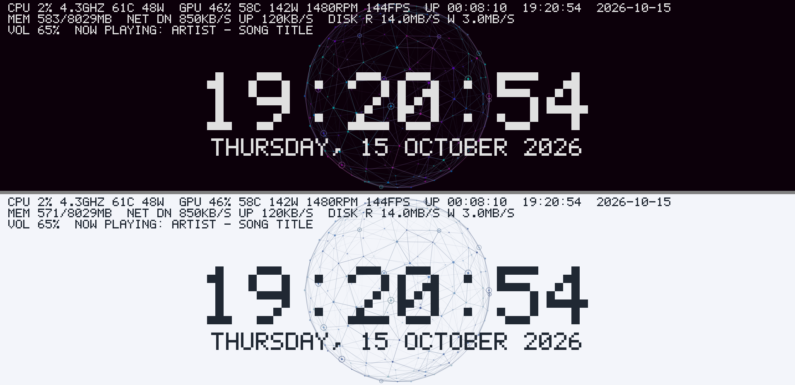

**Light (white) variants.** `effect_theme = light` gives `matrix`, `rain`, `aquarium`, `sea`, `ink`, `network`
and `globe` a **white background**: dark characters and streaks on white paper, a white room with
pale water that deepens in color toward the bottom, or grey-blue lines and nodes on white. `effect_brightness` then sets how saturated the colors
are. Remember to give the text a dark color:

```ini
background_effect = aquarium
effect_theme = light
effect_palette = lagoon
clock_color = #14323C
text_color = #14323C
```

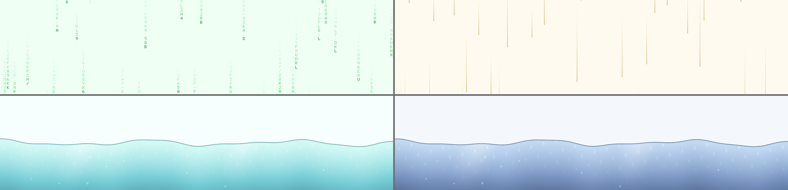

```ini
background_effect = matrix            # a minimal digital rain...
effect_palette = amber                # ...like an old terminal

# background_effect = aquarium        # or an aquarium, water up to 60% of the height
# effect_palette = deep
# effect_level = 60

# background_effect = network         # or nodes and thin lines (globe: a turning sphere)
# effect_theme = light
# effect_palette = crimson
```

It is built to be light: the picture is only calculated on a coarse grid and
stretched through a color table (about a millisecond per frame; the aquarium, a few
milliseconds), and `effect_fps` (default 8) keeps the number of frames low — see
[Performance](PERFORMANCE.md#performance). Details and every key in the
**[Options guide](../OPTIONS_GUIDE.md#animated-background-effect-plasma-aurora-lava-waves-matrix-rain-aquarium-sea-ink-veil-network-globe)**.

### Brightness, DeepCool, FPS

- `brightness = 0-100`: software dimming (no LY brightness command is known).
- Night mode: `night_mode = true`, `night_start = 23:00`, `night_end = 07:00`, `night_brightness = 20`
  dim the picture between two times (the night may cross midnight). Off by default.
  See [Night mode](../OPTIONS_GUIDE.md#night-mode).
- Alerts: `alert_cpu_temp = 90`, `alert_gpu_temp`, `alert_cpu_load`, `alert_gpu_load`, `alert_ram = 95`
  (`0` = off, the default), `alert_delay = 3`, `alert_color` — a pulsing border and the value when a
  reading stays over its limit. See [Alerts](../OPTIONS_GUIDE.md#alerts).
- Profiles: `profiles/gaming.profile` is laid over this file while in use; switch it from the tray, a hotkey
  (`profile_key = ctrl+alt+p`) or by the program in the foreground (`profile_rules = mygame.exe=gaming`).
  See [Profiles](../OPTIONS_GUIDE.md#profiles).
- Themes: `theme = ocean` gives a whole look in one line (your own settings win). You can save your
  own look as a theme, copy it, attach it to a gallery post and import other people's.
  See [Themes](../OPTIONS_GUIDE.md#themes).
- `deepcool = false` (or `--no-deepcool`): never touch the DeepCool display.
- The **CH170 / CH270 / CH690 DIGITAL** case display can show the CPU frequency, the fan speed in RPM
  (from [LibreHardwareMonitor](#fans-and-sensors-librehardwaremonitor)) or both in turn:
  `deepcool_mode = freq | fan | alternate`, `deepcool_fan = cpu | case | pump | gpu | both`,
  `deepcool_alternate = 6` (seconds). They apply live. The display also has a **GPU section**:
  `deepcool_source = cpu | gpu | alternate` chooses CPU, GPU, or both in turn (with `alternate` the CPU
  phases — frequency and/or RPM — are followed by the GPU). The way the display takes the RPM is not
  documented by DeepCool: if the number does not show up on your model, tell us which one it is.
- Game dashboard FPS works on any GPU via ETW (DirectX 9–12 games; run as
  Administrator; Vulkan/OpenGL-native games are not covered). NVIDIA GPU
  temperature/power/clock come from NVML (`nvml.dll`, shipped with the
  driver), falling back to `nvidia-smi`. `--diag` prints what each source
  returns.

### Weather

Current temperature and a small stylized condition icon (sun, cloud, rain,
snow, fog, thunder...), from [Open-Meteo](https://open-meteo.com/) (free, no
API key). By default the location is guessed from the machine's public IP
address; set `weather_city = Milano` (or `--weather-city`) to use a fixed city
instead — changing it needs a restart, since it re-spawns the background
fetch thread. `weather_unit = c` (default) or `f` picks the temperature unit,
and applies live. The weather can be shown two ways: as a per-item line named
`weather` (see "Per-item control" below, `default2`), and/or as its own big
panel (`layout = weather`, or e.g. `layout = default, weather` to rotate with
the standard screen). If the network is unreachable or the location
can't be resolved yet, the item just shows "N/A" until the first fetch
succeeds; nothing else in the program is affected. `--diag` also prints the
resolved location and a sample reading.

The `weather` panel also shows a **7-day forecast strip** below the current
conditions: one column per day, with the abbreviated day name, a small
condition icon, the high/low temperature and (when the model provides it) the
rain probability. It's automatic — no extra config — and comes from the same
Open-Meteo request as the current conditions. In portrait mode the columns
shrink to fit the narrower panel, same idea as everything else that adapts to
orientation.

### Ticker (news headlines, or any custom feed)

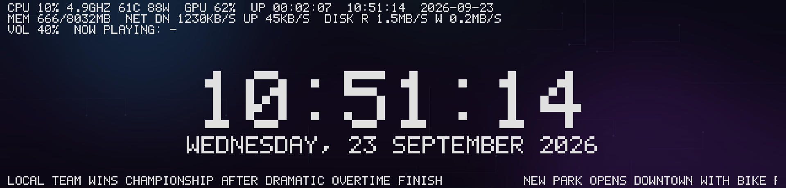

Scrolling headlines from one or more sources, refreshed on a background
thread (same idea as the weather module). Set one or more comma-separated
`ticker_source` entries — each can be an **RSS/Atom feed URL** (headlines
come from each item's title), **any other URL** (not a feed, so each
non-empty line of the response becomes one item — point it at your own
script or webhook), or a **local file path** (one item per non-empty line,
re-read on every refresh). Two independent ways to show it, usable together:
a scrolling line drawn on top of whatever else is on screen (`show`/`hide =
ticker`, styled with `ticker_position`/`ticker_size`/`ticker_color`/
`ticker_backdrop`/`ticker_width`), and/or its own full panel (`layout =
news`). `ticker_source`/`ticker_refresh_min` (default 10 minutes) need a
restart, like `weather_city`; everything else applies live.

```ini
ticker_source = https://www.ansa.it/sito/ansait_rss.xml
ticker_refresh_min = 10
show = ticker
layout = default, news:20
```

See the **[Options guide](../OPTIONS_GUIDE.md#ticker)** for the full reference
and more examples (combining feeds and files, styling the chyron, etc.).

### Preset layouts

`layout = default | cpu-gpu | temps | overview | grid6 | clock-center | io | music | gaming | cpu | gpu | weather | news | tiles | deck | cards | orbit | console | steam | frame`
(`--layout list` prints them). All of them, shown here over a sample background
(`background = img/sample_background.jpg`, `panel_opacity = 60`):

| | | |
|---|---|---|
| 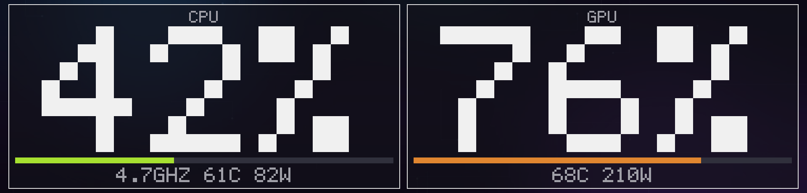<br>`cpu-gpu` | 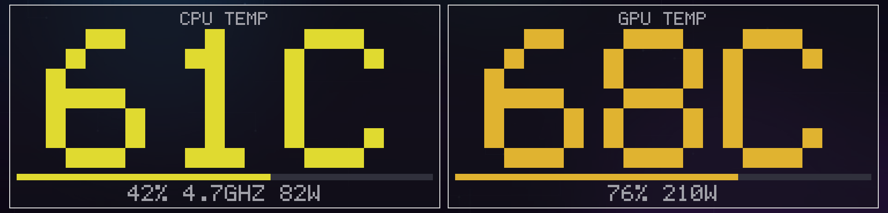<br>`temps` | 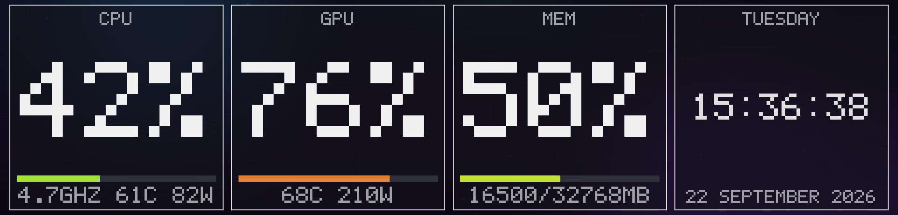<br>`overview` |
| 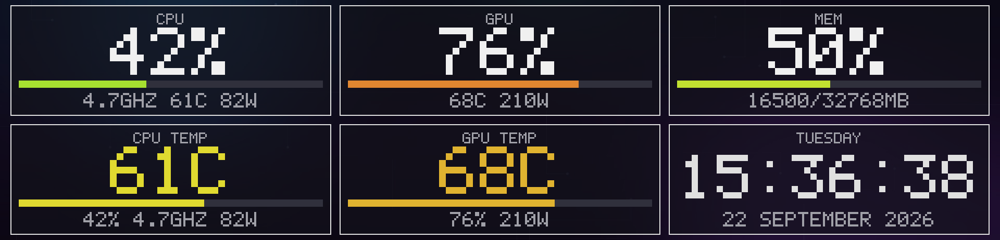<br>`grid6` | 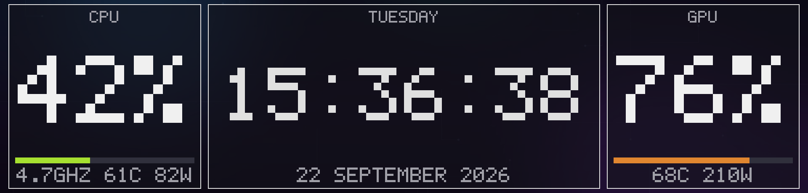<br>`clock-center` | 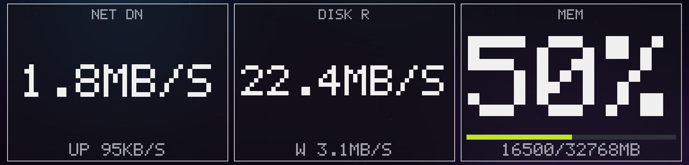<br>`io` |
| 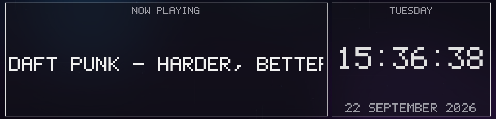<br>`music` | 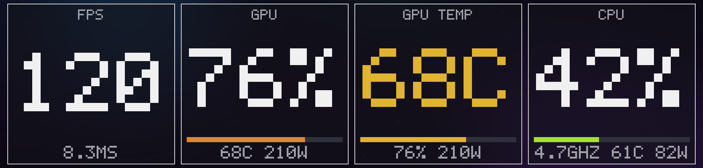<br>`gaming` | 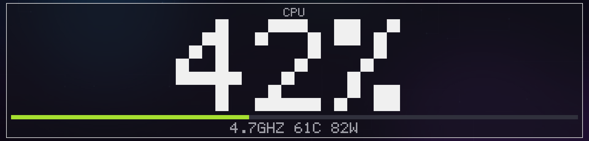<br>`cpu` |
| 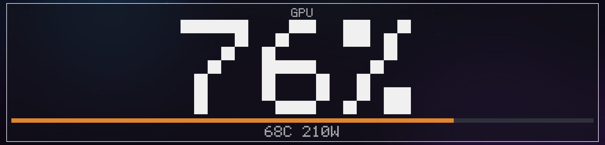<br>`gpu` | 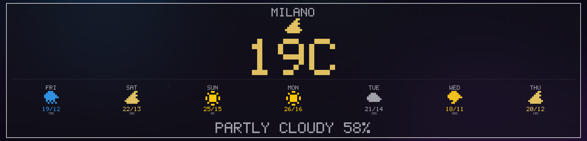<br>`weather` | 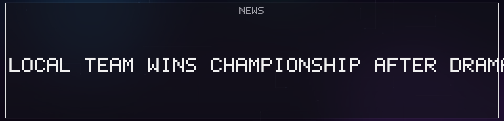<br>`news` |

Several layouts separated by commas rotate every
`layout_interval` seconds (`layout = cpu-gpu, temps, music`). Each entry can also carry its own
duration with `name:seconds`, instead of splitting the time equally — `layout = default:30, weather:5`
keeps the standard screen up for 30s straight, then the weather panel for 5s, then back to 30s of
the standard screen (not alternating every 5s); an entry with no `:seconds` falls back to
`layout_interval`. `default2` is the same screen but with the per-item styling below (`default`
stays classic; per-item options without any `layout` imply `default2`). `default` is the standard
screen (status lines, spectrum, big clock) and can be part of the rotation (`layout = default, cpu-gpu`).
`trofeo_lcd.exe --diag` prints NVIDIA/AMD GPU sensor diagnostics. `text_backdrop = true` puts a panel
behind the status lines and big clock (same opacity); `panel_opacity = 0-100`
makes panels see-through over the background. Big panels replace the clock; portrait stacks
them vertically. See `trofeo.conf.example`. In the [settings editor](../README.md#settings-editor-trofeo_config),
the *Screens (layouts)* section builds the rotation with a list (add, reorder, seconds per screen)
and the preview lets you look at each screen in turn.

### Gaming screens

While a game runs (the GPU stays busy) the LCD switches to a screen made for it. `gaming_layout` chooses among nine designs, all of them drawn for landscape and for portrait:

| | | |
|---|---|---|
| 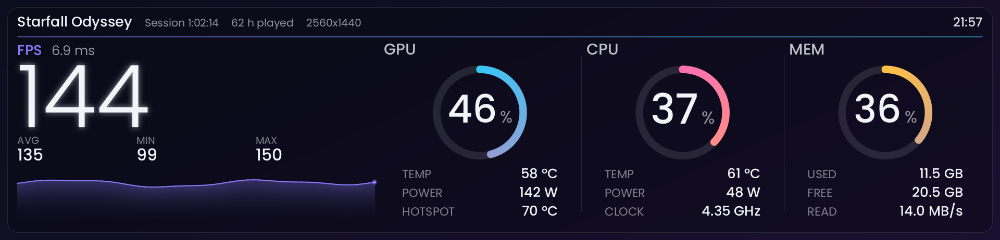<br>`arena` — elegant cards, big FPS, rings | 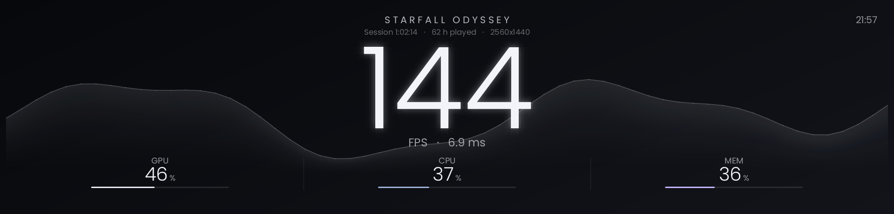<br>`zen` — minimal, the FPS over a soft graph | 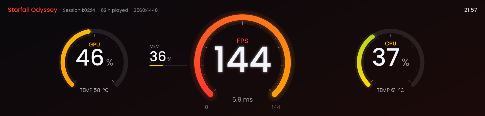<br>`cockpit` — racing dials |
| 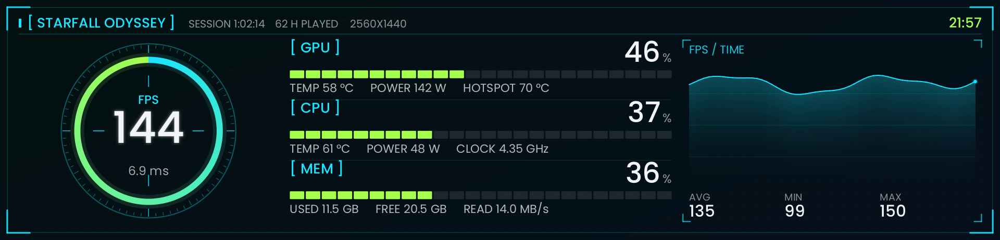<br>`tactical` — HUD with brackets | 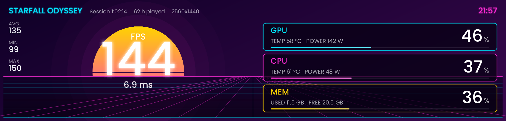<br>`neon` — synthwave sun and grid | 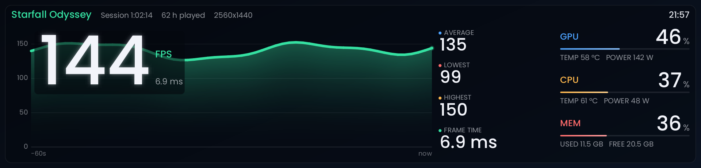<br>`telemetry` — an engineer's chart |
| 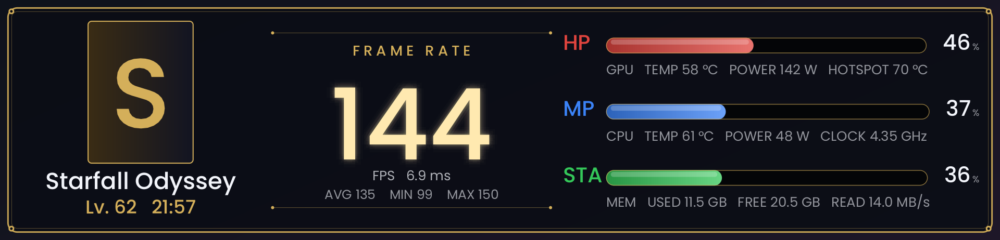<br>`quest` — RPG panels, HP / MP bars | 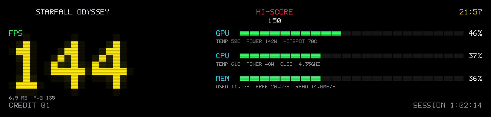<br>`arcade` — pixel font, CREDIT 01, hi-score | 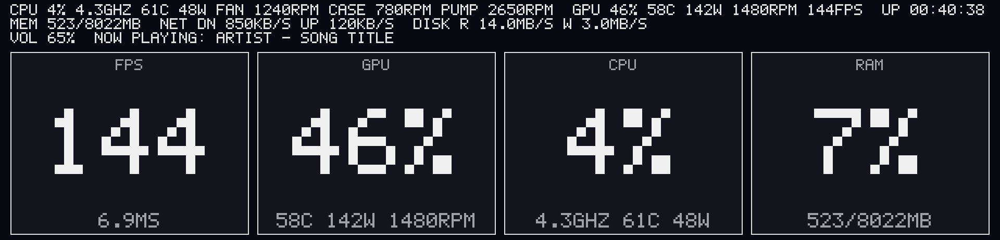<br>`classic` — the old big squares |

Everything is adjustable, in the *Gaming screen* section of the settings editor (whose preview shows a game running) or in the file: the readings (`gaming_items`, up to four of cpu, gpu, ram, fans, net, disk), which number is big (`gaming_hero`), the FPS graph and its history, the FPS at the end of the gauges, the temperature that turns red, the glow, your own colors or a preset, the font, and the background (the design's own, the program's one, a color, a gradient, an animated effect or a picture).

**The game.** The name comes from the program in the foreground: for Steam games from your library (`appmanifest` files), for games of the Epic, GOG and Xbox folders from the install folder, otherwise from the window title or the program's name. The facts under it (`gaming_details`) are the time since the game started, the hours played (Steam), the size of the game window, the RAM the game uses and the store. The cover (`gaming_cover`) is shown by the designs that have room for it. *This part reads the foreground window, so an unusual window title can give an odd name; set `gaming_info = false` to hide it.*

### Steam cover flow

`layout = steam` (or put `steam` in your list of screens, e.g. `layout = default:30, steam:20`) shows your **installed Steam games** as covers sliding by in perspective, with a reflection:

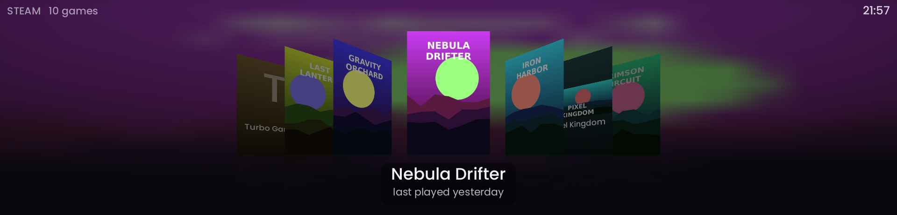

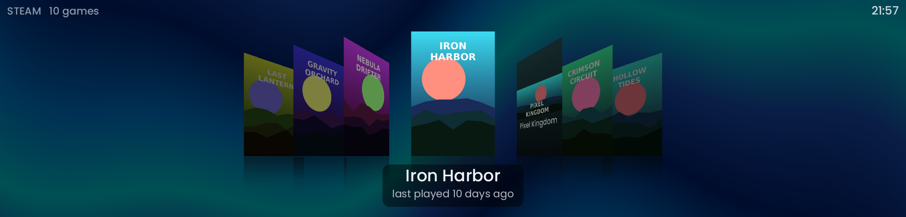

It reads the local Steam folder only (the registry and the usual folders, or `steam_path`): no account, no internet. The covers are the ones Steam has already cached for its library; a game without a cached cover gets a generated card with its initial and name. Tune it with `steam_interval` (seconds per game), `steam_speed` (how long the slide takes), `steam_side` (covers on each side), `steam_tilt`, `steam_reflection`, `steam_order` (recent, name, random), `steam_title` / `steam_details` (name, hours played, last time) and the background: `steam_bg = blur` (the cover in the middle, blurred) or `global | color | gradient | effect | image` for the same backgrounds as everywhere else (an animated one, a picture, ...), so the flow can sit over an aurora or a picture. The row rests on a game for `steam_interval` seconds and then slides to the next; while it rests the screen idles at a few frames a second. In the settings editor the *Steam cover flow* section has a folder picker and a real preview. *Not tried on every PC: if Steam is installed in an unusual place, set `steam_path`.*

### Tiles layout (glass dashboard)


`layout = tiles` shows rounded, semi-transparent tiles with big values, a progress
bar or a ring and an optional second value — the clock, CPU/GPU load, temperatures
and watts, RAM, network, disk, FPS, weather and the playing track. You choose
**which tiles** to show and in which rows, the **font** (anti-aliased "smooth" or the
classic pixel font), the **colors** of the bars and rings (all of them, or one
tile at a time) and what is **behind** the tiles:

```ini
layout = tiles
# Rows are separated by "|"; ":ring" draws a ring instead of a bar,
# "clock:tall" makes the clock as tall as all the rows.
tiles = clock:tall, cpu_temp, gpu_temp | ram:ring, cpu:ring, gpu:ring
tiles_font = smooth                         # smooth | pixel
tiles_theme = dark                          # dark | light
tiles_bar_color = #00C8FF, #FF0080          # all bars and rings: one color or a gradient (default: auto)
tile_gpu_color = #FFC800                    # ...and one tile on its own
tiles_bg = gradient                         # global | color | gradient | effect | image
tiles_bg_color = #1B2A4A, #4A1B3A
```


Tiles: `clock cpu cpu_temp cpu_watt gpu gpu_temp gpu_hotspot gpu_watt ram net disk fps weather music`, and, with
[LibreHardwareMonitor](#fans-and-sensors-librehardwaremonitor), `cpu_fan case_fan pump gpu_fan fans mb_temp disk_temp`.
Backgrounds: whatever the other screens use (`global`), a color, a gradient, the
animated effects of [Backgrounds](#backgrounds-solid-color-and-animated-effects)
(matrix, rain, the aquarium, the network and the globe included),
or an image just for this screen. Works on 1920×462, 1920×400 and in portrait; the
tiles are redrawn only when something changes, so even an animated background costs
little. All the keys are in the [options guide](../OPTIONS_GUIDE.md#tiles-layout). In the
[settings editor](../README.md#settings-editor-trofeo_config) the *Tiles* section lets you build the rows
by picking each tile from a list and toggling *ring* / *tall*.

#### Tile colors from the color presets


By default all the tiles share one fill color. With `tiles_palette` **every tile gets a color of
its own** from the same color presets as the animated backgrounds (`pastel fluo neon candy sunset
ocean aurora fire forest ice mono rainbow`, one-color and water presets, `custom` with your own
`tiles_colors`, or `all`). The colors drift slowly along the preset, and when you list **several
presets they fade from one to the next, tile by tile**: with `tiles_palette_stagger` the tiles
change preset at different moments, so at any time the dashboard is a quilt of colors in the
middle of different fades. The colors are kept dark enough for the white text (or pale enough
for the dark text of `tiles_theme = light`), whatever the preset.

```ini
layout = tiles
tiles_palette = pastel, ocean, sunset       # or: all | fire | custom ... (empty = one color for all)
tiles_palette_interval = 20                 # seconds each preset stays before the next fades in
tiles_palette_stagger = 50                  # 0 = all tiles change together ... 100 = spread over the interval
# tiles_colors = #FF0080, #00C8FF           # your own colors, used by "custom"
```

It is cheap: the colors are quantized, so the tiles are redrawn only when a color really
changes, and the screen asks for 5 frames a second.

### Fans and sensors (LibreHardwareMonitor)

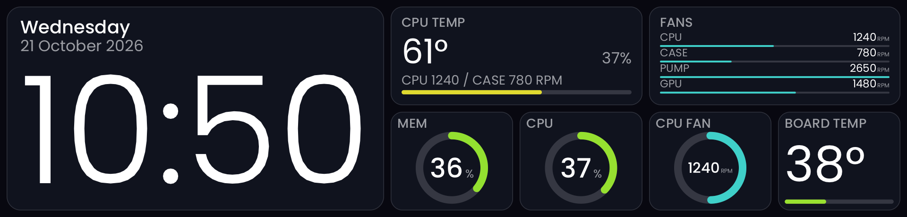

Fan speeds are not something Windows exposes, so they come from
[LibreHardwareMonitor](https://github.com/LibreHardwareMonitor/LibreHardwareMonitor) (free, open
source). Start it **as administrator**, open *Options → Remote Web Server → Run* (port 8085) and
leave it open (it can sit in the tray). trofeo_lcd reads its web server every 2 seconds; when it is
not running nothing happens and the fan items simply stay empty.

What you get:

- a **`CPU 1240 / CASE 780 RPM` line on the CPU tiles** (`tiles_rpm = true`);
- tiles `cpu_fan`, `case_fan`, `pump`, `gpu_fan`, a **`fans`** tile listing all of them with a bar
  each, and `mb_temp` (motherboard) and `disk_temp`;
- `fan 1240rpm case 780rpm pump 2650rpm` in the CPU line of the status screens (`hide = cpu_fan,
  case_fan, pump` removes them);
- the fans in the [Deck, Cards, Orbit and Console](#deck-cards-orbit-and-console) screens;
- the **DeepCool case display** (see [Brightness, DeepCool, FPS](#brightness-deepcool-fps));
- the GPU fan on cards that the driver reports no fan for, and the CPU temperature and power on
  CPUs the built-in sensor does not know.

The program picks the sensors by their names (a fan called "CPU Fan" is the CPU fan, "Pump" the
pump, the other fans are averaged as the case fans). If your board names them differently,
`trofeo_lcd --lhm-list` prints everything LibreHardwareMonitor reports and which sensor each role
uses, and `lhm_cpu_fan = "Fan #2"`, `lhm_case_fan`, `lhm_pump`, `lhm_mb_temp` point a role at a part
of a sensor's name.

```ini
lhm = true                       # false = do not look for LibreHardwareMonitor
lhm_url = http://127.0.0.1:8085
lhm_interval = 2                 # seconds between readings
tiles = clock:tall, cpu_temp, fans | ram:ring, cpu:ring, cpu_fan:ring, mb_temp
tiles_rpm = true
tiles_fan_max = 2500             # the RPM that fills a bar
```

### Deck, Cards, Orbit and Console

Four more full screens from the same readings as the tiles, each with its own character and all
of them chosen from the config (and from the *Deck, Cards, Orbit and Console* section of the settings editor).
They draw a **graph of the last minutes** for the main reading, and take their accent colors from the
presets of the animated backgrounds (`dash_palette`) or from your own list (`dash_colors`).

**`layout = deck`**: instrument columns. A gauge line on top of every column, a big light value, a
sparkline and four small readings in a grid — and, with LibreHardwareMonitor, the fan speeds.

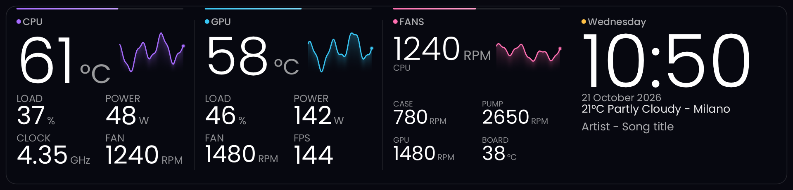

**`layout = cards`**: flat colourful cards in a mosaic. Each card melts into the colour of its
neighbour and carries a ghost silhouette of its own history along the bottom. A column can hold
several stacked cards.

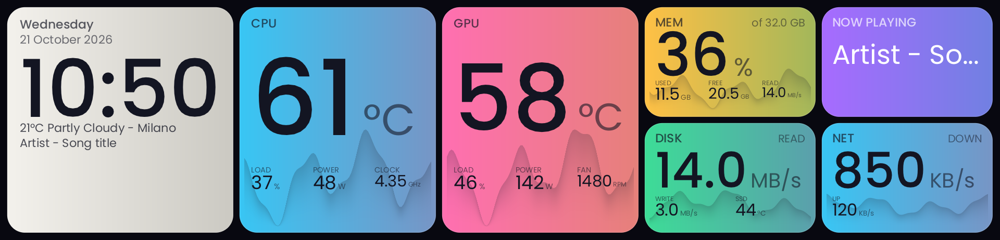

**`layout = orbit`**: a cluster of concentric rings per device (load, temperature, power; RAM,
disk and network; every fan), with the readings beside it and a legend under it, and the clock,
weather and track on the right.

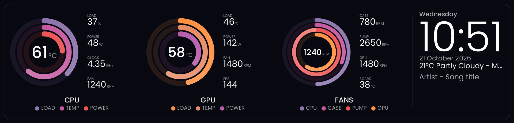

**`layout = console`**: a bar on top with the names of the tiles and the clock, and under it a row of
tiles (up to 7). **One tile is in focus**: it grows, lights up in its colour with a soft glow and shows a graph of
the last minutes and its readings; the others stay small and dim, with the value and a bar. Where the focus goes is
your choice with `console_focus`: `rotate` (the tiles take turns, `console_interval` seconds each), `load` (the focus
follows the busiest of CPU, GPU, RAM, network and disk — it only moves when another one is clearly ahead for a few
seconds, so it does not flicker) or `none` (no focus: all the tiles show their details, side by side). The colours
are the usual `dash_palette` / `dash_colors` / `dash_theme`, so the same layout can be midnight blue, violet,
ember, mint or a light pastel one. The screen is redrawn about once a second, so the focus changes at that pace.

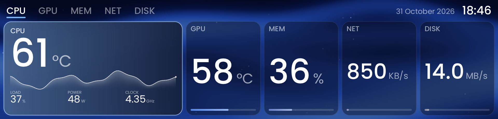

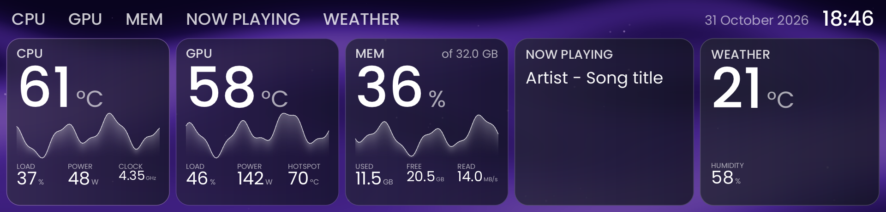

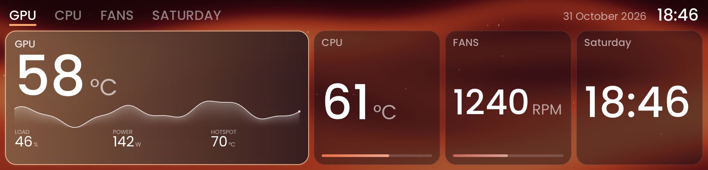

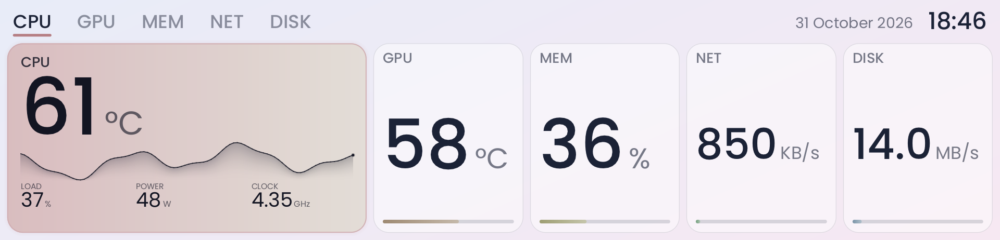

**In portrait** (`orientation = portrait`) the tiles are stacked in a column instead of standing side by side: the
tile in focus is the tall one, the bar on top keeps only the date and the clock.

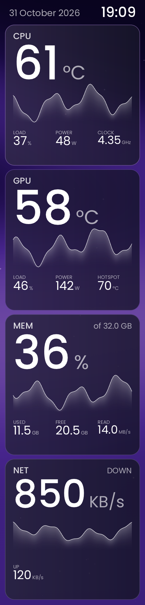

```ini
layout = console
console = cpu, gpu, ram, net, disk   # 1-7 of: cpu gpu ram fans net disk clock weather music fps
console_focus = rotate               # rotate | load | none
console_interval = 6                 # seconds per tile with rotate
console_bar = true                   # the bar with the names and the clock
dash_palette = midnight              # midnight dusk ember mint rose slate pastel ocean ...
dash_bg = effect                     # the animated background behind it
background_effect = veil
effect_palette = midnight
```

```ini
layout = deck
deck = cpu, gpu, ram, clock          # 2-5 of: cpu gpu ram fans net disk clock weather music fps
# layout = cards
cards = clock | cpu | gpu | ram, disk | music, net    # "|" = next column, "," = stacked
# layout = orbit
orbit = cpu, gpu, ram                # 1-4 devices
orbit_clock = true
# layout = console
console = cpu, gpu, ram, net, disk   # 1-7 tiles, the one in focus shows the details
console_focus = rotate               # rotate | load | none
dash_palette = sunset                # default | any preset of the animated backgrounds
# dash_colors = #A76BFF, #38C6F4, #FF6FB1
dash_graph = true
dash_history = 90                    # seconds of history in the graphs
dash_bg = gradient                   # global | color | gradient | effect | image
dash_bg_color = #10142A, #241030
```

**Temperature or load, and the fan.** `dash_hero = temp | load` chooses what is shown big on the CPU and GPU
panels (the other becomes a small reading and the graph follows it); on the cards `cards_fan = true` adds the
fan RPM at the top right (LibreHardwareMonitor).


**GPU hot spot.** The `gpu_hotspot` tile shows the hottest point of the GPU (junction) with the normal GPU
temperature under it. On AMD cards it comes from the Radeon driver (ADL), or from
[LibreHardwareMonitor](#fans-and-sensors-librehardwaremonitor) when the driver does not give it; it is also a small
reading on the GPU panel of `deck`, `cards` and `orbit`, and in the status line with `show = gpu_hotspot`.
Not verified on the RX 9070 series yet: `trofeo_lcd --diag` and `--lhm-list` show what is read.

**Light, dark, see-through.** `dash_theme = light` gives a white panel with dark text and pastel cards;
`dash_plate_color` and `dash_plate` set the colour and the opacity of the panel behind `deck` and `orbit`
(lower it to see an animated background through it, `0` = no panel) and `cards_opacity` the opacity of the
cards:


```ini
layout = orbit
background_effect = aurora
dash_theme = light       # dark | light
dash_plate = 35          # opacity of the panel, 0-100
# dash_plate_color = #FFF4E0
# cards_opacity = 45
```

The screens are redrawn about once a second (the graphs move that often) and only when something
changed. All the keys are in the [options guide](../OPTIONS_GUIDE.md#deck-cards-orbit-and-console).

### Digital frame (picture collage)


`layout = frame` shows the pictures of a folder as a collage in the middle of the screen, with
two slim columns of the glass tiles of the Tiles layout at the sides (by default the clock and
RAM on the left, CPU and GPU on the right). Behind the collage is the current photo, blurred
and darkened.

```ini
layout = frame
frame_folder = C:\Users\Me\Pictures\Holidays
frame_style = mosaic                # mosaic = a tidy collage | polaroid = scattered prints with a white border
frame_photos = 5                    # pictures on screen at once (1-9)
frame_interval = 8                  # seconds between changes; each time ONE picture is replaced
frame_order = shuffle               # shuffle | name
frame_transition = fade             # fade | slide (a wipe in the mosaic, a print dropping in with polaroid)
frame_left = clock, ram:ring        # the tiles at the sides: any of the Tiles list, or "none"
frame_right = cpu:ring, gpu:ring
```

- **Two styles.** `mosaic` cuts the pictures to fit the places of a tidy collage (rounded corners,
  a small gap: `frame_gap`, `frame_radius`; the places have different sizes and shapes, and
  portrait photos are put in the tall ones). `polaroid` lays white-bordered prints with a wider
  strip at the bottom, each tilted a little, with a soft shadow and a piece of tape on some; a
  new print lands on top of the others.
- **One at a time.** Every `frame_interval` seconds one picture is replaced and the rest stands
  still; with `shuffle` every picture is shown before any comes back, and the new one is chosen
  to fit the shape of the place it goes to.
- **Your folder.** JPG, PNG, WebP, BMP and GIF (the first frame) — not HEIC (convert those
  from your phone). The EXIF rotation of phone photos is respected. `frame_recursive = true`
  includes the subfolders. The folder is read again every `frame_refresh` seconds (60), so new
  pictures show up and removed ones go away without restarting. Unreadable files are skipped.
  A missing or empty folder shows a message instead.
- **Background.** `frame_bg = blur` (default; `frame_dim` darkens it), `dark`, or `global` — the
  normal background of the program (an image, or one of the animated effects).
- **The sides** take their look from the Tiles options (`tiles_theme`, `tiles_font`,
  `tiles_color`, `tiles_palette` ...), so the frame and the dashboard always match. They are
  columns on a landscape screen and strips at the top and bottom on a portrait one;
  `frame_side_width` (% of the long side) sets their size, `frame_left = none` leaves a side
  to the pictures.
- **Light on the CPU.** Pictures are decoded and scaled once, on a background thread, straight
  to the size of their place; the finished collage is kept as it is, so while nothing moves the
  program idles at 2 frames a second. A change takes about a second and a half at 20 frames a
  second (about 5-8 ms of drawing per frame), then it goes back to idle.

In the [settings editor](../README.md#settings-editor-trofeo_config) the *Digital frame* section has a
folder picker, the choices above and a **real preview** with your own pictures (the editor adds
the screen to your list with one click).

### Live reload

`trofeo.conf` is re-read every second; saved changes apply without restarting (a broken file is ignored and the previous settings stay). Only `deepcool`, `fps_monitor`, OpenRGB, `hide_console`, `start_in_tray`, `screenshot_key`, `weather_city`, `ticker_source` and `ticker_refresh_min` need a restart. If a saved file is invalid, the previous settings stay active and the reason is written to `trofeo-errors.txt` next to the executable. The [settings editor](../README.md#settings-editor-trofeo_config) relies on this: save in the editor and the LCD updates by itself.

### Per-item control

Every info item (`cpu, gpu, uptime, time, date, mem/ram, net, disk, volume, nowplaying, weather`) can be
turned on/off with `show`/`hide` and styled on its own with `<item>_size` (1-30), `<item>_position`
(3x3 grid), `<item>_color` and `<item>_backdrop`. Setting any of them switches the info block to
per-item mode (items on the same position stack, and the track scrolls without overlapping its
neighbors). Details inside the CPU/GPU lines can be hidden with
`hide = cpu_freq, cpu_temp, cpu_power, gpu_temp, gpu_hotspot, gpu_power, gpu_fan, gpu_clock, gpu_fps, cpu_fan, case_fan, pump`.
`clock_time_size` / `clock_date_size` set the big clock's sizes, and `net_unit` (`kb|mb|auto`) /
`mem_unit` (`mb|gb`) set the network and RAM units. `percent_decimals = 1` adds a decimal place to
every CPU/GPU/RAM usage percentage shown anywhere (`37%` → `37.4%`); default `0` keeps the original
whole-number look.

### New version notice


Off by default. With `update_check = true` the program asks GitHub, **once at start-up**, for the latest
release of the project (a single small HTTPS request; nothing about your computer is sent, and nothing is
downloaded or installed). If that release is newer than the version you are running, a banner appears at the
bottom of the screen, on top of whatever is shown, and disappears by itself. When there is no network, or
GitHub does not answer, nothing happens and nothing is shown.

```ini
update_check = true              # false (default) = never connect
update_notice_secs = 8           # how long the banner stays on screen (2-120)
update_check_hours = 0           # 0 = only at start-up; 24 = check again every day (max 720)
```

All three are in the settings editor (System section) and need a restart of `trofeo_lcd`. The banner is in the
language of `language`. To see how it looks without waiting for a release, start the program with
`--update-demo`: it pretends that version 99.0.0 exists.
