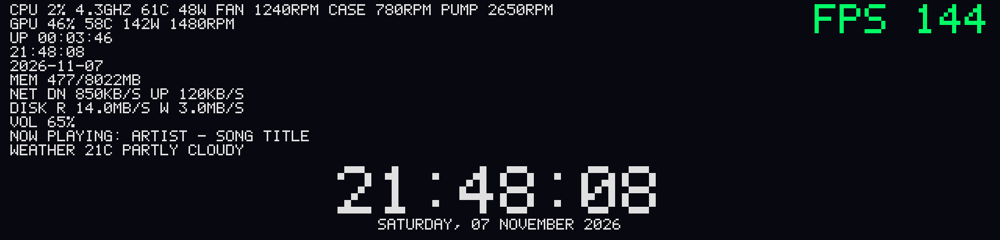

# Version history

[← Back to the README](../README.md) · [All the docs](./README.md)

**2.23.0 — five new built-in screens.** `layout = halo | gauges | terminal | horizon | ribbon`: **halo** (two big rings for CPU and GPU, the clock in the middle, memory below), **gauges** (four dials: load and temperature of CPU and GPU), **terminal** (green-on-black readout, one line per device), **horizon** (a huge clock and three thin lines of load) and **ribbon** (clock, song and weather above a ribbon of readings). Each has a version for portrait panels, chosen by itself. They are free layouts that come with the program, so no file is needed; in the settings editor *Screens → Layout builder → Copy a built-in design* makes a file of yours to change, and a file of yours with the same name takes the place of the built-in one.

**2.22.0 — free layouts.** A screen you design yourself: `layouts/<name>.layout`, one element per line (`text`, `bar`, `ring`, `rect`, `image`), positions and sizes in % of the screen, texts with live `{values}`, bars and rings with a range and a "hot" color. Used with `layout = name` like any screen; looked at again every second, so a saved change shows at once. In the settings editor, *Screens → Layout builder* shows the screen as the program draws it with a box over every element: drag, resize, edit the details, copy, order, lock, undo and redo; every change is saved at once. Your layouts also appear in the list of screens. See [the options guide](../OPTIONS_GUIDE.md#free-layouts--design-your-own-screen).

**2.21.0 — profiles.** A profile is a text file `profiles/<name>.profile` next to the configuration file; while it is in use what it says wins over the file (not over the command line). It can be chosen by hand (tray menu *Profile*, settings editor *Screens → Profiles*, or the hotkey `profile_key = ctrl+alt+p`, which goes round them), named in `profile = name`, or picked by the program in the foreground: `profile_rules = mygame.exe=gaming, code.exe=work` (it goes back 5 seconds after leaving the program). Only settings that apply live can be in a profile. Off unless you make one. See [the options guide](../OPTIONS_GUIDE.md#profiles).

**2.20.0 — your own themes, to save, export and share.** In the settings editor, *Share your design → Your themes*: **Save my look as a theme** writes `themes/<name>.theme` next to the configuration file, and `theme = <name>` brings it back (the *Theme* list shows your themes after the built-in ones). **Copy the text** gives the theme as text; **Save my look as a theme file to attach** writes `<name>.theme.txt` next to the gallery picture (the gallery form has a *Theme file* box for it); **Import a design → Import as a theme** and **Import a theme file...** save the themes of other people. Only the look can be in a theme; a theme of your own is written out as its settings when you copy the settings for a gallery post. See [the options guide](../OPTIONS_GUIDE.md#your-own-themes--save-export-share-import).

**2.19.0 — themes, night mode and alerts.** `theme` (settings editor, *Colors and text*) applies one of eight looks — `midnight`, `ocean`, `sunset`, `forest`, `ember`, `neon`, `matrix`, `mono` — as **defaults**: anything you set yourself wins. `night_mode`, `night_start`, `night_end`, `night_brightness` (*Screen*) dim the display between two times, also across midnight. `alert_cpu_temp`, `alert_gpu_temp`, `alert_cpu_load`, `alert_gpu_load`, `alert_ram`, `alert_delay`, `alert_color` show a pulsing border and a bar with the value when a reading stays over its limit for a few seconds (a short spike is ignored). Everything is off by default. Fixed: the gallery's "share" rule hid the opacity settings (`tiles_opacity`, `cards_opacity`, …) because their names end in "city". See [the options guide](../OPTIONS_GUIDE.md#themes).

**2.18.1 — the documentation is reorganised.** The README is now a short introduction (what it shows, install, supported panels, the settings editor, the gallery) and the rest moved to the [docs](./README.md) folder: features, sensors, panels, the configuration cookbook, command-line options, autostart, performance, troubleshooting, this history and the code structure. Nothing else changed.

**2.18.0 — a clearer settings editor.** A **search box** at the top of the list finds any setting by its name, its key (`clock_format`) or its hint, in English or Italian, and lets you change it right there; the sections are **grouped by theme** (Screen and sensors, Look, Screens, Music and games, Online, System, Share); **Settings I changed** shows only what is written in your file, each with its `x` to go back to the default; after saving, a notice says which of the changed settings **need a restart** of `trofeo_lcd`; and on *Share your design* you can **import** a design pasted from the gallery. See [the options guide](../OPTIONS_GUIDE.md#settings-editor-trofeo_config).

**2.17.0 — share your design in the gallery.** The settings editor has a new page, *Share your design* (last in the list): it asks the running program for a picture of what is on the screen, shows it so you can check it, copies the settings that make up the look (no files, folders, city, sensors or system settings) and opens the project's gallery form on GitHub, where you drop the picture and paste the settings. The gallery is the list of issues with the label `gallery`: [see it here](https://github.com/haven80/trofeo-lcd-rs/issues?q=is%3Aissue+label%3Agallery). Nothing is sent by the program: you post it yourself, with your own GitHub account. See [the options guide](../OPTIONS_GUIDE.md#share-your-design).

**2.16.2 — `hid_resend_ms` for 6.86 screens that blink or go blank.** If the whole screen dims, blinks or disappears between pictures, `hid_resend_ms = 1` (settings editor, *Screen*) keeps sending the last picture from a thread of its own, also while the next one is being drawn. Off by default; it helped on the one screen it was tried on. See [the options guide](../OPTIONS_GUIDE.md#trofeo-vision-686-and-the-04165302-family).

**2.16.0 — a fade between screens.** `screen_fade_ms = 600` (settings editor, *Colors and text*) makes the old picture melt into the new one whenever the screen changes: the layout rotation, the music screen, the gaming screen, the spectrum. `screen_fade_style = black` fades out to black first. **Off by default** (`0`), and when it is off it costs nothing. See [the options guide](../OPTIONS_GUIDE.md#fade-between-screens).

**2.15.0 — start minimised in the tray, and a 12-hour clock.** `start_in_tray = true` (or `--start-in-tray`; settings editor, *System*) hides the console window once the program is running and leaves an icon in the tray: a click shows or hides the window, the right button opens a menu with *Open settings editor*, *Show / Hide window* and *Exit*. Off by default, Windows only. And, from 2.14.0, `clock_format = 12h` shows the time as `2:05 PM` on every clock (`clock_ampm = false` drops the AM / PM). See [the options guide](../OPTIONS_GUIDE.md#start-minimised-in-the-tray-restart-required-windows).

**2.14.0 — 12-hour clock.** `clock_format = 12h` (settings editor: *Look*, "Time format") shows the time as `2:05 PM` on every clock of the program; `clock_ampm = false` drops the AM / PM.

**2.13.0 — eight new designs for the music screen.** `music_layout = vinyl | poster | minimal | radial | equalizer | wave | cassette | vu` (or pick it in the settings editor, Music section) replaces the card with a spinning record and tonearm, a poster with a huge title, a minimal title, rays around the cover, an LED equaliser, soft waves, a cassette with turning reels, or two analogue VU meters. They use the same `music_bg`, `music_progress` and `music_stats` as the card, with `music_colors`, `music_font`, `music_clock`, `music_album` and `music_glow` on top. See [the options guide](../OPTIONS_GUIDE.md#music-screen-now-playing-card).

**2.12.0 — FPS panel in deck, cards, orbit and console.** `fps` is now a panel like `cpu` or `gpu`: `deck = cpu, gpu, fps, ram`, `orbit = cpu, gpu, fps`, `console = gpu, fps, cpu`, `cards = cpu, gpu | fps, ram` (or pick it in the settings editor, Deck, Cards, Orbit and Console). It shows the FPS of the running game with a graph, the frame time and the GPU load, and "no game" otherwise.

**2.11.0 — the FPS in your own layout.** If you don't want a separate gaming screen, `fps_item = true` (a checkbox in the settings editor, *Single items*) adds an "FPS 144" item to the standard screens (`default`, `default2`) while a game gives FPS; with `gaming_screen = false` you keep your layout and get the FPS in it. In per-item mode it has its own size, position and color (`fps_size`, `fps_position`, `fps_color`, `fps_backdrop`). See [the options guide](../OPTIONS_GUIDE.md#what-to-show--show--hide).

**2.10.3 — `fps_driver_divisor`, for games Windows gives no frame events for.** With the 2.10.2 diagnostics the doubled FPS was traced: half of the `Present` calls are window checks (`DXGI_PRESENT_TEST`) and 2.10.2 no longer counts them, so DX11, DX12 and Vulkan games read right. An exclusive-fullscreen DX9 game gives Windows no frame events at all, so only the Radeon driver's figure is left, and it read double there (122 for a game capped at 60). `fps_driver_divisor = 2` (config file, applies live) halves that figure and only that one; the default `1` changes nothing. See [In-game FPS dashboard](../OPTIONS_GUIDE.md#in-game-fps-dashboard-restart-required).

**2.10.2 — doubled FPS on Radeon: the diagnostic showed what is going on, and the program now guards against it.** The `--fps-diag` output of a Radeon RX 6700 XT showed that the Windows events carry about 2.1 `Present` calls for every frame the AMD overlay and PresentMon count, from two threads on a single swap chain, while the driver's own figure was close to the real one. So the extra calls are not frames. Now the calls made with the `DXGI_PRESENT_TEST` flag (a window check that draws nothing, which PresentMon also ignores) are not counted, the driver's figure is steadied against its occasional jumps, and with `fps_source = auto` the driver's figure is used whenever the event count reads far above it. `--fps-diag` now also prints the flags of the calls and what the screen would show. See [In-game FPS dashboard](../OPTIONS_GUIDE.md#in-game-fps-dashboard-restart-required).

**2.10.1 — a second attempt at the doubled FPS on Radeon cards, and a tool to find out for sure.** 2.9.4 fixed one possible cause and a user's test showed the number was still doubled (RX 6700 XT, tested with a DX12 and a Vulkan game). Two things were still unaccounted for, so both are handled: on Radeon cards the program showed the *driver's* own FPS figure first and only used the Windows events when the driver gave none, and the Windows events themselves can report one frame twice (the same `Present` raising the event again from inside), which PresentMon filters out and this program did not. Now the frames counted from the Windows events come first (with nested calls merged, like PresentMon), the driver's figure is the fallback, and `fps_source = auto | etw | driver` picks one. If the number is still wrong, `trofeo_lcd.exe --fps-diag` (as administrator, game in front) prints what every source reads. See [In-game FPS dashboard](../OPTIONS_GUIDE.md#in-game-fps-dashboard-restart-required).

**2.10.0 — eight gaming screens, the name of the game, and a Steam cover flow.** The big squares you saw while gaming are now just one of nine designs (`gaming_layout = classic | arena | zen | cockpit | tactical | neon | telemetry | quest | arcade`), each one drawn for landscape and portrait and fully adjustable (colors, font, background, which readings, the FPS graph). The program now finds out **which game is running** — from the program in the foreground, and for Steam games from your library — and shows its name, the time since it started, the hours played on Steam, the window resolution and the RAM it uses. And `layout = steam` is a new screen of its own: your installed Steam games as a **cover flow**, the box art sliding by in perspective with a reflection over the blurred cover or any background of the program. See [the gaming screens](CONFIGURATION.md#gaming-screens) and [the Steam cover flow](CONFIGURATION.md#steam-cover-flow). New in this version and not yet tried on every PC: see the notes under each section.

**2.9.4 — the FPS counter no longer shows double on Windows.** On some systems (reported on an AMD RX 6700 XT) the FPS read correctly for the first second and then doubled. The cause was that Windows delivers the frame events in batches of about a second and the program dated them when the batch arrived instead of when the frame happened. Every frame is now dated with its own timestamp, so the number is the real rate whatever the batches. Nothing to configure.

**2.9.3 — fixes for the Windows autostart and the settings editor.** The autostart script no longer fails with *"Cannot bind argument to parameter 'Path' because it is an empty string"* and finds `trofeo_lcd.exe` by itself (also one folder up, where the release zip puts it); the README explains it step by step, including the quotes needed around folders with spaces. The settings editor now **remembers its language** instead of always starting in Italian, and no longer stops with *"The requested operation requires elevation (os error 740)"* when `trofeo_lcd.exe` is set to run as administrator. See [Autostart on Windows](AUTOSTART.md#autostart-on-windows).

**2.9.1 — the gaming screen can be switched off.** `gaming_screen = false` (a checkbox in the settings editor) keeps your own screen while you play instead of switching to the in-game dashboard, and the switch now waits for the GPU to stay busy for a few seconds (`gaming_delay`), so a one-second spike on the desktop no longer flashes it. The README also explains how to run the autostart scripts when Windows blocks them. See [the gaming screen](../OPTIONS_GUIDE.md#the-automatic-gaming-screen-applies-live).

**2.9.0 — a console-style look: a new background and a new layout, and `deck`, `cards` and `orbit` finally work in portrait.** `background_effect = veil` is slow, silky bands of light drifting over a deep night gradient with a few floating specks (six new night palettes: `midnight`, `dusk`, `ember`, `mint`, `rose`, `slate`). `layout = console` is a bar with the names and the clock over a row of tiles: the tile in focus grows, lights up in its colour and shows a graph and its readings, the others stay small and dim. The focus can **rotate** by itself, **follow the busiest part of the PC** or be **off**, and the colours come from the same presets as the other layouts. In portrait, `deck`, `cards`, `orbit` and `console` now stack their parts in a column (before, `deck`, `cards` and `orbit` were squeezed into thin strips). See [Veil](CONFIGURATION.md#backgrounds-solid-color-and-animated-effects), [Console](CONFIGURATION.md#deck-cards-orbit-and-console) and [Orientation](CONFIGURATION.md#orientation-landscape--portrait).

**2.7.1 — fixes for Radeon cards:** the **GPU usage** now comes from the Radeon driver (what the Radeon software shows) instead of the Windows counter, which only sees the 3D engine and could read about 40 % lower; and the **GPU hot spot** now shows in the `deck`, `cards` and `orbit` layouts on cards that do not report their power (such as the RX 9070 XT). See [Which sensors you need](SENSORS.md#which-sensors-you-need-and-what-to-install).

**2.7.0 — two new liquid backgrounds, and the water can follow your PC and your music.** `background_effect = sea` is a sunset over layers of waves with foam and the sun's glitter, `ink` is clouds of coloured ink curling in water. The aquarium and the sea can **rise and fall with the CPU, GPU or RAM load** (`effect_level_source`), and the aquarium, sea and ink can **move with the music** (`effect_reactive`). See [Animated background](CONFIGURATION.md#backgrounds-solid-color-and-animated-effects).

**2.6.1 — the aquarium can be turned upside down** (`effect_flip = true`, or *Upside down* in the editor): the water hangs from the top of the panel.

**2.6.0 — a notice when a new version is out** (optional, off by default): the program looks on GitHub at start-up and, if a newer version exists, shows a banner at the bottom of the screen for a few seconds. Switch it on in the settings editor (System section) or with `update_check = true`. See [New version notice](CONFIGURATION.md#new-version-notice).

**2.5.1 — a new README section, [Which sensors you need and what to install](SENSORS.md#which-sensors-you-need-and-what-to-install)**: what to install for each reading (PawnIO for AMD CPUs, LibreHardwareMonitor for Intel CPUs and the fans, the graphics driver for the card) and what to run when a value is missing.

**2.5.0 — the Trofeo Vision 6.86 is confirmed working**, and the other screens of its family
(USB `0416:5302`) are open to try: other sizes with JPEG pictures, and the small 320×240 screens with RGB565
pictures. The settings editor has a **screen test** (Screen section) that finds the orientation for you, and the
program can also be started with `--lcd-test`. See [Supported panels](../README.md#supported-panels).
