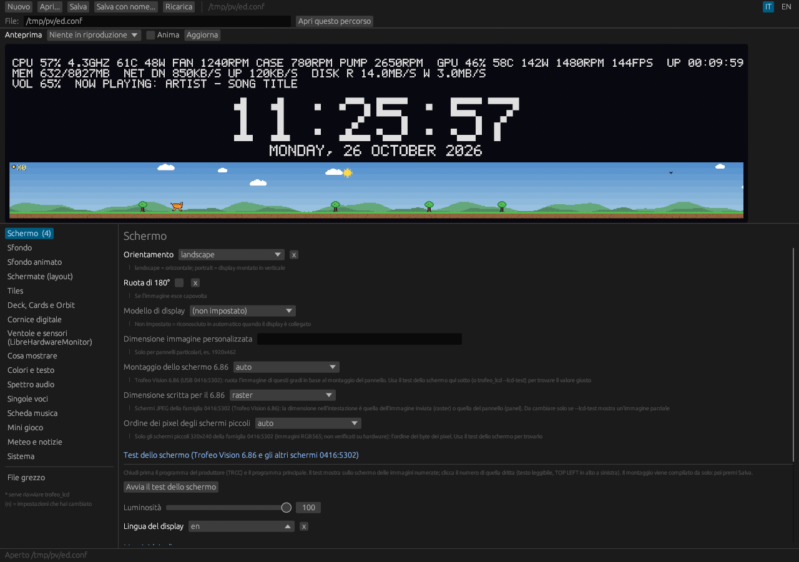

# Supported panels

[← Back to the README](../README.md) · [All the docs](./README.md)

| Panel | Picture size | Setting |
|---|---|---|
| Trofeo Vision 9.16 | 1920×462 | default |
| Trofeo Vision 11.3 | 1920×400 | recognised automatically, or `panel = trofeo-11.3` |
| Trofeo Vision 6.86 | 1280×480 | recognised automatically (USB `0416:5302`), or `panel = trofeo-6.86` |

**Trofeo Vision 6.86 (confirmed working).** It is a different device from the 9.16": USB ID `0416:5302`
and the "HID Type 2" protocol (a 20-byte header plus a JPEG, sent in 512-byte reports), taken from the
open-source [thermalright-trcc-linux](https://github.com/Lexonight1/thermalright-trcc-linux) project.
It is recognised by itself and works as it is for most units. If the picture comes out turned, rotated or
partial, find the right orientation with the **screen test**: close the vendor program (TRCC), open the settings
editor, go to **Screen** and press *Start the screen test*. Numbered pictures appear on the screen; click the
number of the one that is upright (readable text, `TOP LEFT` in the top left corner) and press Save. The same
test runs from the command line with `trofeo_lcd --lcd-test` (it asks for the number and writes the values into
`trofeo.conf`). The values are `hid_mount = 0 | 90 | 180 | 270` and `hid_header = raster | panel`; they apply live.
The console prints what the screen answers (model bytes and size) — please paste it in an issue if something does
not work. On Linux install `99-trofeo-lcd.rules` (it includes the 6.86).



**Other screens of the same family (`0416:5302`, not verified).** The model is read from the screen at start-up and
the picture size follows it, so other Vision screens that take JPEG pictures should work the same way (the
console prints the model bytes and size; if a model is not in the program's table, set `panel_size`). The small
**320×240** screens take **RGB565** pictures (a 240×320 raster): they are supported too, with `hid_mount` (90 or
270) and `hid_rgb565 = little | big` found by the same screen test (4 pictures). Not supported: the screens that
do not answer the handshake (some Frozen Warframe SE units restart on it) and the 320×320 RGB565 model.
If you have one of these screens, tell us whether it works — see
[the options](../OPTIONS_GUIDE.md#trofeo-vision-686-and-the-04165302-family).

The 11.3" panel uses the same USB ID (`0416:5408`) and the same handshake as the
9.16", so it is **recognised automatically** from the handshake (byte 20 of the
reply = 5). If it is not, or for any other size, set it by hand in `trofeo.conf`:

```ini
panel = trofeo-11.3        # trofeo-9.16 | trofeo-11.3
# panel_size = 1920x400    # or any WIDTHxHEIGHT (wins over `panel`)
```

Every screen (default, layouts, music screen, pixel game, animated backgrounds)
adapts to the panel size, in landscape and in portrait. At start-up the console
prints `Connected: ... PM=.. SUB=..` and the canvas/panel size in use.
**The 11.3" support has not been verified on real hardware yet**: if the picture
is shifted, cropped or the panel stays black, please open an issue and paste
those two console lines. For `trofeo_screen` (second-monitor mode) pass
`--panel trofeo-11.3` and use a virtual display of 1920×400 (400×1920 in portrait).
